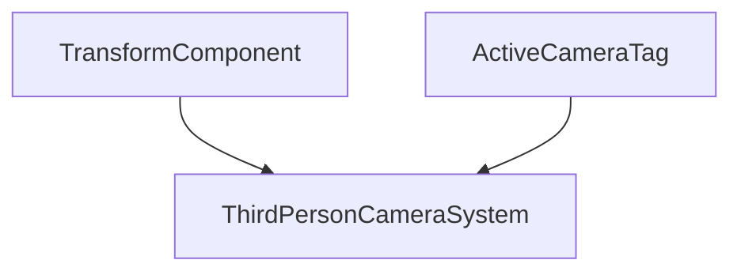

# Diagram Renderer Skill

本スキルは、Markdownプレビューやチャット環境で自動レンダリングされないダイアグラムを、決定論的かつ高解像度な画像（PNG / SVG）として出力・埋め込むための標準手順を定めたものです。

---

## 1. 適用判断基準

エージェントがユーザーに対して以下の内容を説明・提示する場合、**アスキーアート（記号図）やMermaid生テキストのみの提示を禁止し、本スキルを適用して画像化を行う**。

*   クラス構造、ECSアーキテクチャ、モジュール間の依存関係
*   処理フロー、アニメーション遷移、ステートマシン
*   クォータニオン、カメラ姿勢、3D座標系基底、ベクトル演算の幾何学的図解

---

## 2. 方式分類（Mermaid PNG vs SVG）

| 図の種類 | 推奨フォーマット | 生成手段 |
|---|---|---|
| **論理構造・処理フロー**<br/>（シーケンス図、フローチャート、クラス図、ECS関係図） | **PNG** | Mermaid CLI (`@mermaid-js/mermaid-cli`) |
| **連続空間幾何学・ベクトル図**<br/>（クォータニオン回転、3D座標系、視錐台、Slerp円弧） | **SVG** | SVG 直接生成（正確な数学座標系） |

---

## 3. 手順A: Mermaid から PNG 画像を生成する手順

### Step A1: Mermaid 定義ファイル (`.mmd`) の書き出し
一時ディレクトリ（scratch 等）に `.mmd` 形式で定義ファイルを出力する。



### Step A2: Mermaid CLI コマンドの実行
Node.js 環境の `npx` を用いて、白背景の高解像度 PNG を出力する。

```powershell
npx -y @mermaid-js/mermaid-cli -i "<input_path>.mmd" -o "<output_path>.png" -b white
```

### Step A3: Markdown / チャットへの埋め込み
生成された画像のローカル絶対パスを Markdown 画像リンクとして記述する。

```markdown

```

---

## 4. 手順B: 3次元幾何学図解（SVG）を生成する手順

3次元空間の姿勢・ベクトル・角度は Mermaid では表現できないため、数学的に正確な座標を指定した SVG ファイルを作成する。

### Step B1: SVG テンプレート構造
```xml
<svg xmlns="http://www.w3.org/2000/svg" viewBox="0 0 600 450" width="600" height="450">
  <defs>
    <!-- 矢印マーカーの定義 -->
    <marker id="arrow" viewBox="0 0 10 10" refX="5" refY="5" markerWidth="6" markerHeight="6" orient="auto-start-reverse">
      <path d="M 0 0 L 10 5 L 0 10 z" fill="#007acc" />
    </marker>
    <marker id="arrow-rot" viewBox="0 0 10 10" refX="5" refY="5" markerWidth="6" markerHeight="6" orient="auto-start-reverse">
      <path d="M 0 0 L 10 5 L 0 10 z" fill="#e74c3c" />
    </marker>
  </defs>

  <!-- 背景 -->
  <rect width="100%" height="100%" fill="#ffffff" rx="8" stroke="#e1e4e8" stroke-width="2"/>

  <!-- タイトル -->
  <text x="300" y="35" font-family="sans-serif" font-size="16" font-weight="bold" text-anchor="middle" fill="#24292e">
    タイトル
  </text>

  <!-- 座標軸・幾何要素 -->
  <!-- ... -->
</svg>
```

### Step B2: Markdown / チャットへの埋め込み
```markdown

```

---

## 5. ファイル保存先のルール

1. **会話中（チャット一時図）**:
   * アシスタントの scratch ディレクトリ（`<appDataDir>\brain\<conversation-id>\scratch\`）に保存する。
2. **恒久ドキュメント（`Document/` 内）**:
   * プロジェクトルート直下の `Document/Images/` ディレクトリ内に保存し、相対パスまたは絶対パスでリンクする。
