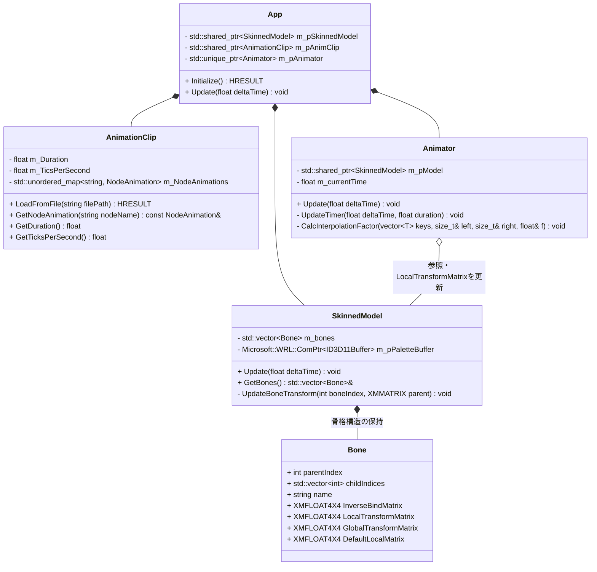
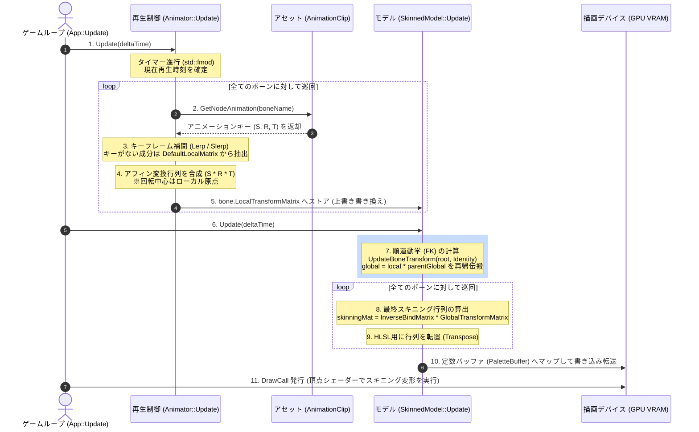

# 【第17回演習】骨格アニメーション・システム 設計図 ＆ 処理フロー解説書

本ドキュメントは、DirectX 11ゲームエンジンにおける「第17回演習：骨格アニメーションの再生と順運動学（FK）」で実装された主要機能のアーキテクチャ設計、処理フロー、およびクラス間の連携関係をまとめた設計仕様書です。

---

## 1. システム・アーキテクチャ（クラス設計）

アニメーションシステムは、主に3つの機能クラスと、それらを保持する `GameObject` / `App` で構成されています。



---

## 2. 毎フレームの処理フロー（シーケンス図）

毎フレーム、ゲームループの更新処理（Update）が走った際、データがどのように各クラスを巡回し、GPUへと転送されるかを示すフロー図です。



---

## 3. アセットロード時のデータフロー

モデル（FBX）とアニメーション（FBX）がそれぞれ別ファイルからロードされ、インポーターによってメモリ上にどのように展開・マージされるかを示す図です。

```mermaid
graph TD
    subgraph モデルロード (Model/SwordMan.fbx)
        A[Assimp::Importer] -->|ConvertToLeftHanded| B[各ノードの Transformation をロード]
        B -->|ConvertMatrix で転置コピー| C[Bone.LocalTransformMatrix]
        C -->|初期姿勢として不変退避| D[Bone.DefaultLocalMatrix]
        A -->|mOffsetMatrix をロード| E[Bone.InverseBindMatrix]
    end

    subgraph アニメーションロード (Animation/Sword And Shield Idle.fbx)
        F[Assimp::Importer] -->|ConvertToLeftHanded| G[アニメーションチャンネル群]
        G -->|_$AssimpFbx$_ サフィックスをトリミング| H[本来のボーン名へクレンジング]
        H -->|位置と回転のキーフレームを合流| I[NodeAnimation にマージして格納]
    end
```

---

## 4. 骨格構造（Bone）と行列パレットの対応設計

### 4.1. C++側：ボーン情報と定数バッファのメモリレイアウト
* 各ボーンは `m_bones` 配列（`std::vector<Bone>`）としてフラットに管理されています。
* GPUに送る行列パレット（`PaletteBufferData`）は、最大256個の 4x4 行列を保持する連続したメモリ領域です。

```
[C++ メモリ領域]
PaletteBufferData (アライメント16)
├─ Bones[0] : 転置された SkinningMatrix (Bone[0]用)
├─ Bones[1] : 転置された SkinningMatrix (Bone[1]用)
│  ...
└─ Bones[255]: 転置された SkinningMatrix (Bone[255]用)
```

### 4.2. HLSL（頂点シェーダー）側：スキニング計算
頂点シェーダー（`LambertianVertexShader.hlsl`）内では、頂点データ（`SkinnedVertex`）に含まれる **`BlendIndices`（影響するボーンのインデックス4個）** と **`BlendWeight`（各ボーンの影響重み4個）** を用いて、頂点位置をブレンド変形させます。

$$\mathbf{V}_{\text{final}} = \sum_{i=0}^{3} \left( \mathbf{V}_{\text{local}} \cdot \mathbf{M}_{\text{Bones[BlendIndices}[i]\text{]}} \right) \times \text{BlendWeight}[i]$$

* **HLSLコード設計**:
```hlsl
cbuffer PaletteBuffer : register(b1)
{
    matrix gBones[256]; // 行列パレット (定数バッファ)
};

struct VS_INPUT
{
    float3 Pos          : POSITION;
    float3 Normal       : NORMAL;
    float4 Color        : COLOR;
    float2 TexCoord     : TEXCOORD;
    uint4  BlendIndices : BLENDINDICES; // 影響するボーンのID 4つ
    float4 BlendWeight  : BLENDWEIGHT;  // 影響度（合計 1.0f）4つ
};

VS_OUTPUT main(VS_INPUT input)
{
    VS_OUTPUT output;
    
    // スキニング行列をブレンド合成
    matrix skinMatrix = 
        gBones[input.BlendIndices.x] * input.BlendWeight.x +
        gBones[input.BlendIndices.y] * input.BlendWeight.y +
        gBones[input.BlendIndices.z] * input.BlendWeight.z +
        gBones[input.BlendIndices.w] * input.BlendWeight.w;
        
    // 頂点位置をアニメーション後の絶対空間へ変形
    float4 localPos = float4(input.Pos, 1.0f);
    float4 skinnedPos = mul(localPos, skinMatrix);
    
    // ... 以降、通常の行列変換 (World * View * Projection) を実行 ...
}
```

---

## 5. 専門用語集

* **順運動学 (Forward Kinematics: FK)**
  * 関節のローカルの回転や移動から、親→子の階層順に乗算を繰り返すことで、各パーツの絶対的なワールド空間座標を算出する手法。
* **逆バインド行列 (Inverse Bind Matrix)**
  * メッシュの初期状態（バインドポーズ）におけるワールド空間内の頂点を、ボーンの関節のローカル原点まで引き戻すための行列。
* **行列パレット (Matrix Palette / スキニング行列配列)**
  * シェーダーへ一度に転送される、各ボーンの「InverseBindMatrix × GlobalTransformMatrix」を計算した変形用行列の一連の配列バッファ。
* **アフィン変換 (Affine Transformation)**
  * 拡大縮小（Scale）、回転（Rotation）、平行移動（Translation）の組み合わせで表現される、直線性と平行性を保つ幾何学的変換。
* **コロン・メジャー (Column-Major / 列優先) と ロー・メジャー (Row-Major / 行優先)**
  * 2次元の行列データをメモリ上の1次元配列にどのように並べるかという規格。DirectXMathは行優先（Row-Major）ですが、HLSLのデフォルトやシェーダーレジスタは列優先（Column-Major）を期待するため、CPUから送る前に転置（Transpose）処理が必要になります。
