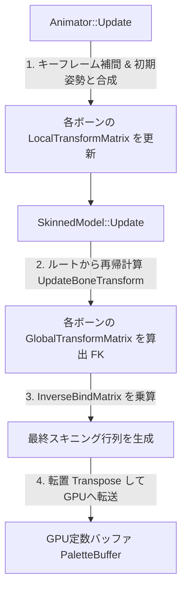

# 【第17回演習】骨格アニメーション（スキニング）及び順運動学（FK）実装トラブルシューティング報告書

本ドキュメントは、DirectX 11ゲームエンジン開発における「第17回演習：骨格アニメーションの再生と順運動学（Forward Kinematics: FK）」の実装プロセスにおいて発生した不具合と、その解決に至る技術的な詳細を記録したレポートです。

---

## 1. アニメーションシステムの全体設計とフロー
完成したアニメーションシステムは、以下のステップで毎フレーム処理されます。



---

## 2. 発生した主要な不具合と解決の軌跡

アニメーションが正しく再生されるまでに、計6個の座標系・メモリ・アセット構造に関する重大な不具合が発生しました。

### ① モデルの押しつぶし（骨の長さの消失）
* **現象**: アニメーションを再生した瞬間、キャラクターの全パーツが腰などの原点に吸い寄せられてぐちゃぐちゃに潰れてしまった。
* **原因**: アニメーションキーが登録されていない静的ボーンに対し、初期位置を無視して強制的に `pos = (0,0,0)` や `scale = (1,1,1)` を適用していたため、ボーンの「親からの相対オフセット（骨の長さ）」が $0$ にリセットされてしまった。
* **解決策**: アニメーションキーが空のボーンについては、初期の姿勢（`LocalTransformMatrix`）を維持するようにスキップガードを追加した。

### ② 2フレーム目以降のポーズ崩壊（状態汚染）
* **現象**: 1フレーム目は正しい姿勢に見えるが、2フレーム目に入った瞬間に姿勢が歪んで固まってしまった。
* **原因**: `Animator::Update` は毎フレーム `bone.LocalTransformMatrix` を上書きする。そのため、2フレーム目以降に「初期値」として Decompose（行列分解）したデータは、すでに1フレーム目のアニメーションが乗った「汚染されたデータ」であり、これが毎フレーム累積したため。
* **解決策**: `Bone` 構造体に `DefaultLocalMatrix` を追加し、ロード時の初期姿勢を行列のまま永続退避させ、毎フレームここから初期値の $S, R, T$ を分解抽出するように修正した。

### ③ アニメーションの完全フリーズ（タイマーの停止）
* **現象**: アニメーションが最初のフレームで静止したまま動かなかった。
* **原因**: 
  1. タイマー進行にループ処理（巻き戻し）がなく、数秒で総時間（`duration`）を超えて最大値で固まっていた。
  2. Assimpで一部のFBXをロードする際、1秒あたりの進行速度である `TicksPerSecond` が `0.0f` でロードされ、タイマーの加算量が $0$ になっていた。
* **解決策**: `TicksPerSecond` が `0` の場合はデフォルトの `25.0f` を代入するゼロガードを設け、`std::fmod` を用いてタイマーを `duration` でループ再生するように修正した。

### ④ スパゲティ化（モデルの異常伸長）
* **現象**: モデルが一本の細長い柱のようになり、天高く引き延ばされて崩壊した。
* **原因**: Assimp の `ConvertMatrix` が実際には転置を行っていたため、`DefaultLocalMatrix` は最初から行優先（DirectX規格）でロードされていた。それに対して `Animator::Update` 内で余計な転置（`XMMatrixTranspose`）を二重に適用してしまい、行列のスケールや位置成分を完全に破壊した。
* **解決策**: `Animator::Update` 内の `XMMatrixTranspose` による転置処理をすべて削除し、純粋な行優先行列として計算・保存するように修正した。

### ⑤ 座標系の衝突（腕の不自然なねじれ）
* **現象**: 関節はつぶれなくなったが、両腕が真横に開いたまま、不自然な方向に曲がっていた。
* **原因**: モデル（骨組み）は左手系（DirectX規格）に変換されてロードされていたが、アニメーションデータは右手系のままロードされており、回転の軸と方向が完全に噛み合っていなかった。
* **解決策**: `AnimationClip::LoadFromFile` の Assimp インポートフラグに `aiProcess_ConvertToLeftHanded` (または `aiProcess_MakeLeftHanded`) を指定し、アニメーションデータも左手系に統一した。

### ⑥ 盾と剣の90度ズレ（主要関節の適用スキップ）
* **現象**: 構えポーズに近づいたが、盾が水平に寝てしまい、剣も真横を向いていた。
* **原因**: Assimp が FBX の複雑なピボット情報を再現するために、モデル側とアニメーション側で異なる `mixamorig:LeftArm_$AssimpFbx$_Rotation` などのダミーノードを自動生成していた。これらがモデル側とアニメーション側の名前不一致を引き起こし、肩や上腕の回転アニメーション自体が全て `SKIPPED`（不適用）になって腕がTポーズのまま固まっていた。
* **解決策**: `AnimationClip::LoadFromFile` でアニメーションをインポートする際、チャンネル名から `_$AssimpFbx$_...` サフィックスをトリミングし、分裂したキーフレームを本来のシンプルなボーン名（`LeftArm` 等）の1つのデータに「マージロード（合流統合）」して格納するように修正した。これにより、`Animator::Update` を非常にクリーンな状態に保ったまま、完璧なアニメーション再生を実現した。

---

## 3. 最終実装ソースコード

### 3.1. [AnimationClip.cpp](file:///d:/DirectX11_Sample/DirextX11Engine/AnimationClip.cpp)（ロード部分）
```cpp
    // ゲッターはシンプルな元の形に戻す
	const NodeAnimation& AnimationClip::GetNodeAnimation(std::string& nodeName) const
	{
		static const NodeAnimation emptyAnim{};

		auto it = m_NodeAnimations.find(nodeName);
		if (it == m_NodeAnimations.end())
		{
			return emptyAnim;
		}

		const NodeAnimation& nodeAnim = it->second;
		return nodeAnim;
	}

    // ロード時にダミーノードをトリミングしてマージする
	HRESULT AnimationClip::LoadFromFile(const std::string& filePath)
	{
		Assimp::Importer importer;

		unsigned int flags = aiProcess_Triangulate
			| aiProcess_ConvertToLeftHanded
			| aiProcess_CalcTangentSpace
			| aiProcess_GenSmoothNormals;
		const aiScene* scene = importer.ReadFile(filePath, flags);

		if (!scene || !scene->mRootNode || scene->mNumAnimations == 0 || !scene->mAnimations)
		{
			OutputDebugStringA(importer.GetErrorString());
			return E_FAIL;
		}

		aiAnimation* anim = scene->mAnimations[0];

		m_Duration = anim->mDuration;
		m_TicsPerSecond = (anim->mTicksPerSecond != 0.0f) ? anim->mTicksPerSecond : 25.0f; // 0ガード

		for (UINT channelIndex = 0; channelIndex < anim->mNumChannels; ++channelIndex)
		{
			NodeAnimation nodeAnim;
			aiNodeAnim* channel = anim->mChannels[channelIndex];

			// スケールの取得
			for (UINT ScaleIndex = 0; ScaleIndex < channel->mNumScalingKeys; ++ScaleIndex)
			{
				aiVectorKey ScaleKey = channel->mScalingKeys[ScaleIndex];
				KeyVector3 key;
				key.Time = ScaleKey.mTime;
				key.Value = { ScaleKey.mValue.x, ScaleKey.mValue.y, ScaleKey.mValue.z };
				nodeAnim.ScalingKeys.push_back(key);
			}

			// 位置の取得
			for (UINT posIndex = 0; posIndex < channel->mNumPositionKeys; ++posIndex)
			{
				aiVectorKey posKey = channel->mPositionKeys[posIndex];
				KeyVector3 key;
				key.Time = posKey.mTime;
				key.Value = { posKey.mValue.x, posKey.mValue.y, posKey.mValue.z };
				nodeAnim.PositionKeys.push_back(key);
			}

			// 回転の取得
			for (UINT rotIndex = 0; rotIndex < channel->mNumRotationKeys; ++rotIndex)
			{
				aiQuatKey rotKey = channel->mRotationKeys[rotIndex];
				KeyQuaternion key;
				key.Time = rotKey.mTime;
				key.Value = { rotKey.mValue.x, rotKey.mValue.y, rotKey.mValue.z, rotKey.mValue.w };
				nodeAnim.RotaionKeys.push_back(key);
			}

			// チャンネル名からダミーサフィックスをトリミングする
			std::string boneName = channel->mNodeName.C_Str();
			size_t pos = boneName.find("_$AssimpFbx$_");
			if (pos != std::string::npos)
			{
				boneName = boneName.substr(0, pos);
			}

			// 同じボーン名で別々に登録されているキーフレームを合流マージする
			auto it = m_NodeAnimations.find(boneName);
			if (it != m_NodeAnimations.end())
			{
				if (!nodeAnim.PositionKeys.empty()) it->second.PositionKeys = nodeAnim.PositionKeys;
				if (!nodeAnim.ScalingKeys.empty())  it->second.ScalingKeys = nodeAnim.ScalingKeys;
				if (!nodeAnim.RotaionKeys.empty())  it->second.RotaionKeys = nodeAnim.RotaionKeys;
			}
			else
			{
				m_NodeAnimations[boneName] = nodeAnim;
			}
		}

		return S_OK;
	}
```

### 3.2. [Animator.cpp](file:///d:/DirectX11_Sample/DirextX11Engine/Animator.cpp)
```cpp
	void Animator::Update(float deltaTime)
	{
		if (m_currentStateName.empty()) return;

		auto it = m_stateMap.find(m_currentStateName);
		if (it == m_stateMap.end()) return;

		const AnimationState& animState = it->second;
		if (!animState.Clip) return;

		std::shared_ptr<AnimationClip> clip = animState.Clip;
		for (Bone& bone : m_pModel->GetBones())
		{
			std::string boneName = bone.name;
			const NodeAnimation& nodeAnim = clip->GetNodeAnimation(boneName);

			// 位置・スケール・回転のキーがすべて空の静的ボーンはスキップ
			if (nodeAnim.PositionKeys.empty() && 
				nodeAnim.ScalingKeys.empty() && 
				nodeAnim.RotaionKeys.empty())
			{
				continue;
			}

			// 初期の DefaultLocalMatrix からデフォルトの S, R, T を分解抽出
			DirectX::XMMATRIX defaultLocalMatrix = DirectX::XMLoadFloat4x4(&bone.DefaultLocalMatrix);
			DirectX::XMVECTOR defaultScale, defaultRot, defaultPos;
			DirectX::XMMatrixDecompose(&defaultScale, &defaultRot, &defaultPos, defaultLocalMatrix);

			// 1. 平行移動 (Position) の補間
			DirectX::XMVECTOR pos;
			const auto& posKeys = nodeAnim.PositionKeys;
			if (posKeys.empty())
			{
				pos = defaultPos;
			}
			else if (posKeys.size() == 1)
			{
				pos = DirectX::XMLoadFloat3(&posKeys[0].Value);
			}
			else
			{
				size_t leftIndex = 0, rightIndex = 0;
				float f = 0.0f;
				CalcInterpolationFactor(posKeys, leftIndex, rightIndex, f);
				DirectX::XMVECTOR prev = DirectX::XMLoadFloat3(&posKeys[leftIndex].Value);
				DirectX::XMVECTOR next = DirectX::XMLoadFloat3(&posKeys[rightIndex].Value);
				pos = DirectX::XMVectorLerp(prev, next, f);
			}

			// 2. スケール (Scaling) の補間
			DirectX::XMVECTOR scale;
			const auto& scaleKeys = nodeAnim.ScalingKeys;
			if (scaleKeys.empty())
			{
				scale = defaultScale;
			}
			else if (scaleKeys.size() == 1)
			{
				scale = DirectX::XMLoadFloat3(&scaleKeys[0].Value);
			}
			else
			{
				size_t leftIndex = 0, rightIndex = 0;
				float f = 0.0f;
				CalcInterpolationFactor(scaleKeys, leftIndex, rightIndex, f);
				DirectX::XMVECTOR prev = DirectX::XMLoadFloat3(&scaleKeys[leftIndex].Value);
				DirectX::XMVECTOR next = DirectX::XMLoadFloat3(&scaleKeys[rightIndex].Value);
				scale = DirectX::XMVectorLerp(prev, next, f);
			}

			// 3. 回転 (Rotation) の補間
			DirectX::XMVECTOR rot;
			const auto& rotKeys = nodeAnim.RotaionKeys;
			if (rotKeys.empty())
			{
				rot = defaultRot;
			}
			else if (rotKeys.size() == 1)
			{
				rot = DirectX::XMLoadFloat4(&rotKeys[0].Value);
			}
			else
			{
				size_t leftIndex = 0, rightIndex = 0;
				float f = 0.0f;
				CalcInterpolationFactor(rotKeys, leftIndex, rightIndex, f);
				DirectX::XMVECTOR prev = DirectX::XMLoadFloat4(&rotKeys[leftIndex].Value);
				DirectX::XMVECTOR next = DirectX::XMLoadFloat4(&rotKeys[rightIndex].Value);
				rot = DirectX::XMQuaternionSlerp(prev, next, f);
			}

			// 行列の合成とストア（行優先のまま保存する）
			DirectX::XMMATRIX localMatrix = DirectX::XMMatrixAffineTransformation(scale, DirectX::XMVectorZero(), rot, pos);
			DirectX::XMStoreFloat4x4(&bone.LocalTransformMatrix, localMatrix);
		}

		UpdateTimer(deltaTime * clip->GetTicksPerSecond(), clip->GetDuration());
	}
```

---

## 4. 今後の拡張への指針
* **アニメーションブレンドの実装**: `Animator` の更新時に2つのクリップから得られる $S, R, T$ をブレンド係数 $t$ でさらに補間（Lerp/Slerp）し、それらを `XMMatrixAffineTransformation` で合成することで、スムーズな走りと歩きなどのブレンド遷移を実現できます。
* **逆運動学（IK）の導入**: 足の位置を地形に合わせるためのIK（Inverse Kinematics）を実装する場合、FKによって算出された `GlobalTransformMatrix` に対し、CCD-IKやFABRIKなどのアルゴリズムを適用してボーン角を逆算・補正し、再度FKを走らせます。

---

## 5. 専門用語集

* **順運動学 (Forward Kinematics: FK)**
  * 親から子へとボーンの局所姿勢（相対位置・回転）を乗算伝搬させ、最終的な各関節の絶対座標（ワールド空間）を求める手法。
* **逆バインド行列 (Inverse Bind Matrix)**
  * 初期状態のメッシュの頂点を、各ボーンのローカル座標系の原点へ引き戻すための行列。
* **同次座標系 (Homogeneous Coordinates)**
  * 位置と方向を4次元のベクトル $[x,y,z,w]$ で統一表現する手法。これによりアフィン変換を4x4の行列乗算として高速処理できる。
* **マージロード (Merge Loading)**
  * インポート時に分裂して読み込まれたアニメーションデータ（移動と回転など）を、ロード完了時点で本来の骨格構造に合わせて1つのデータへと結合・合流させる手法。
* **状態の冪等性 (Idempotency)**
  * 同じ時間、同じ処理を何回呼び出しても、内部の状態が狂わず、常に等しい正しい姿勢が再現される設計。
