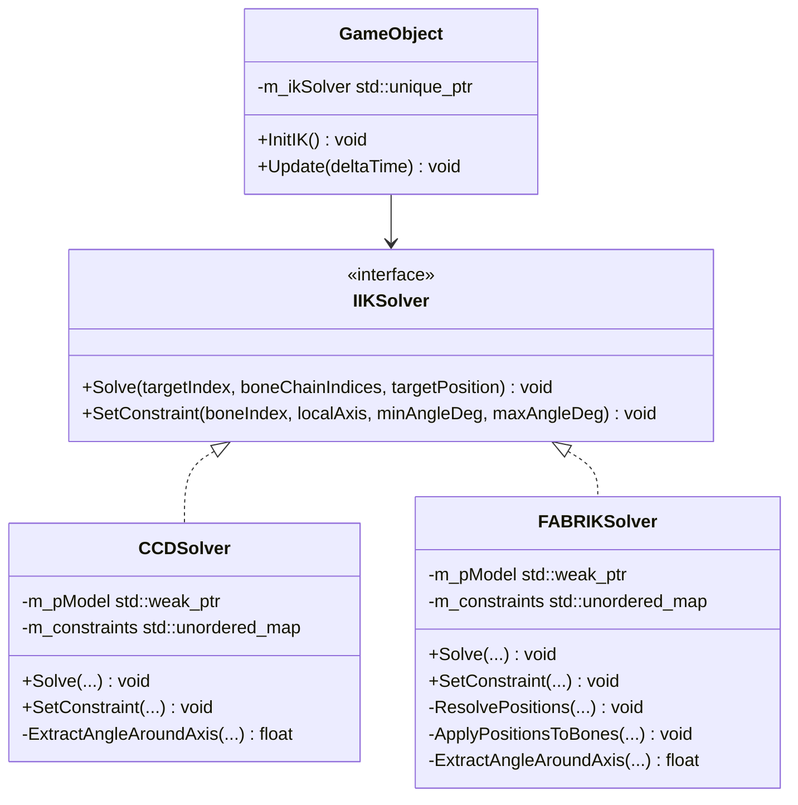
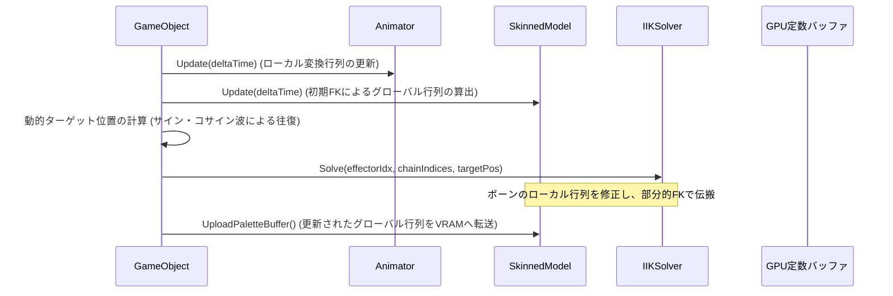

# 演習18 逆運動学 (IK) システム: アーキテクチャ設計書

このドキュメントは、DirectX11エンジンに実装された逆運動学（IK）システムのアーキテクチャ設計と数学的モデルについて説明します。本システムは、骨格アニメーションのアーキテクチャとスムーズに統合され、共通のインターフェースを通じて複数のIKアルゴリズムをサポートします。

---

## 1. システム概要とコアインターフェース

本IKシステムは、**単一責任の原則 (SRP)** および **リスコフの置換原則 (LSP)** に基づいて設計されています。ゲームオブジェクトのロジックから具体的なIKソルバーの実装を隠蔽（抽象化）することで、実行時に異なるアルゴリズム（CCDやFABRIKなど）をシームレスに切り替えることができます。

### [IIKSolver.h](file:///d:/DirectX11_Sample/DirextX11Engine/IIKSolver.h)
すべてのIKソルバー実装の基本となる抽象インターフェース。関節の制限データ構造（`JointConstraint`）を内包し、異なるソルバー間で骨格の物理的な限界設定を共有できるように設計されています。

---

## 2. グローバル実行データフロー

IKの計算は、キーフレームアニメーションによる初期の順運動学（FK）処理の直後に行われ、GPUに行列パレットを送信する前にボーンの行列を直接上書きします。

---

## 3. ソルバーアルゴリズムの設計

### 3.1. CCD (Cyclic Coordinate Descent) ソルバー
反復的な回転ベースのソルバー。関節チェーンを末端（エフェクタの親）からルート（根本）に向かって逆順に処理し、各関節において「関節からエフェクタへのベクトル」と「関節からターゲットへのベクトル」が一致するように順次回転を計算します。

#### コアループのロジック:
1. 現在の関節からエフェクタへのベクトル $\vec{V}_{eff}$ と、ターゲットへのベクトル $\vec{V}_{tgt}$ をグローバル空間で抽出。
2. グローバル空間での回転軸を算出: $\vec{A}_{global} = \vec{V}_{eff} \times \vec{V}_{tgt}$。
3. 回転軸 $\vec{A}_{global}$ を関節のローカル空間に変換。
4. 差分角度を算出: $\theta = \arccos(\vec{V}_{eff} \cdot \vec{V}_{tgt})$。
5. ローカル差分クォータニオンを現在のローカル回転に乗算: $Q_{new} = Q_{old} \times Q_{delta}$。
6. 角度制約（ある場合）を適用。
7. 子孫ノードのグローバル行列を再計算（部分的FK）。

---

### 3.2. FABRIK (Forward And Backward Reaching) ソルバー
位置ベースのソルバー。反復計算のループ中は回転行列の計算を一切行わず、3D空間上で関節の「座標点」を直接移動させ、最後に確定した座標から回転を逆算する2段階のアプローチをとります。

#### 前方到達フェーズ (Forward Reaching: ターゲット $\rightarrow$ ルート):
エフェクタの位置をターゲット位置に強制配置し、そこからルートに向けて、本来のボーンの長さを維持するように手前の関節を引き戻していきます：
$$\vec{P}_{i} = \vec{P}_{i+1} + \vec{D} \times d_i$$
（※ $\vec{D} = \text{Normalize}(\vec{P}_i - \vec{P}_{i+1})$、 $d_i$ はボーンの物理的な初期長）

#### 後方到達フェーズ (Backward Reaching: ルート $\rightarrow$ ターゲット):
移動してしまったルート関節を元のグローバル固定位置（骨盤など）に戻し、そこからエフェクタに向けて関節を順番に押し出していきます：
$$\vec{P}_{i+1} = \vec{P}_i + \vec{D} \times d_i$$
（※ $\vec{D} = \text{Normalize}(\vec{P}_{i+1} - \vec{P}_i)$）

#### 位置から回転へのバインド処理 (Position-to-Rotation Binding):
位置が確定した後、ルートからエフェクタに向けて走査し、元のボーンの向きと最適化後のボーンの向きを一致させる回転を算出し、親ボーンのグローバル回転を取り除いてローカル回転に変換します：
$$Q_{local\_new} = (Q_{orig\_global} \times Q_{diff}) \times Q_{parent\_global}^{-1}$$

---

## 4. 関節角度制限システム (1Dヒンジ制限)

膝の曲がりのように、特定のローカル軸まわりでのみ回転を許可する制限を設計します。

### 角度抽出とクランプの数式:
任意のローカルクォータニオンから、指定された制限軸 $\vec{A}_{limit}$ まわりの回転角を抽出します：
1. クォータニオンのベクトル部分と制限軸の内積を算出（回転方向の射影）：
   $$d = (x, y, z) \cdot \vec{A}_{limit}$$
2. `atan2` を用いて半角を計算：
   $$\frac{\theta}{2} = \text{atan2}(d, w)$$
3. 実際の回転角度 $\theta = 2 \times \frac{\theta}{2}$ を求め、範囲を $[-\pi, \pi]$ に正規化。
4. 角度 $\theta$ を指定された最小角/最大角 $[min, max]$ の範囲内にクランプし、クォータニオンを再構築：
   $$Q_{clamped} = \cos(\theta/2) + \vec{A}_{limit}\sin(\theta/2)$$

---

## 5. 堅牢なアーキテクチャ設計

### 5.1. ダミーノードのバイパス設計
MixamoやFBXモデルで自動挿入される「長さが0の補正用ダミーノード」（例: `LeftLeg_$AssimpFbx$_Translation`）による破綻を防ぐ設計：
* ボーン長（$d_i$）をローカル行列からではなく、初期バインド状態のグローバル座標の差分から計測。
* 距離が極めて小さい（$len < 0.0001f$）場合は、ベクトルの正規化をスキップし、前点と同じ座標を代入することでゼロ除算（$NaN$ の発生）を完全に防ぎます。

### 5.2. 部分的FKによる処理負荷の最適化
ソルバーの反復毎にモデル全体の骨格を更新するのではなく、IKの影響下にあるボーン階層のみを更新する `UpdateChainFK` を実装し、複数キャラクターが同時にIKを動かした際のCPUオーバーヘッドを削減しています。
