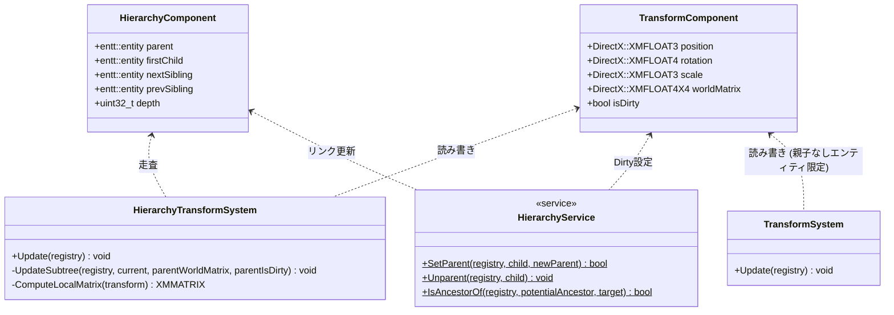
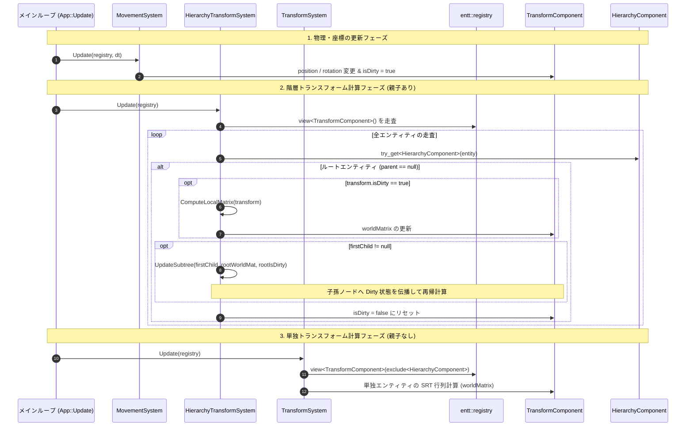
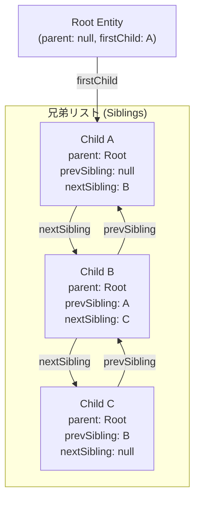

# 演習19 階層トランスフォーム (Hierarchy Transform) システム: アーキテクチャ設計書

本ドキュメントは、DirectX11エンジンおよびECS（Entity Component System: EnTT）環境における、ゲームオブジェクトの親子関係管理と階層トランスフォーム（Hierarchy Transform）システムのアーキテクチャ設計、メモリレイアウト、および数学的モデルについて説明します。

---

## 1. クラス設計 (システム・アーキテクチャ)

本システムは、**単一責任の原則 (SRP: Single Responsibility Principle)** と **データ指向設計 (Data-Oriented Design)** に基づき、トランスフォームデータ、階層リレーション構造、関係操作サービス、および階層行列更新システムの4つの責務に完全分離されています。

### 1.1. コンポーネント定義
*   [`TransformComponent`](file:///d:/DirectX11_Sample/DirextX11Engine/Components.h#L23-L31): 局所姿勢（Position, Rotation, Scale）と計算済みワールド行列キャッシュ（`worldMatrix`）、および自身の変更検知フラグ（`isDirty`）を保持します。親子関係を持たない単独のエンティティにも付与されます。
*   [`HierarchyComponent`](file:///d:/DirectX11_Sample/DirextX11Engine/Components.h#L169-L177): 親子関係を持つエンティティにのみ付与される構造体。LCRS（Left-Child Right-Sibling）双方向リンクリスト形式により、固定サイズ（ヒープメモリ確保ゼロ）でツリー構造を表現します。

### 1.2. 操作サービスとシステム
*   [`HierarchyService`](file:///d:/DirectX11_Sample/DirextX11Engine/HierarchyService.h#L9-L88): 親子付け替え（`SetParent`）、リンク切り離し（`Unparent`）、および循環参照検出（`IsAncestorOf`）を提供する操作境界クラス。
*   [`HierarchyTransformSystem`](file:///d:/DirectX11_Sample/DirextX11Engine/HierarchyTransformSystem.h#L8-L21): ルートノードから子孫ノードへツリーを巡回し、Dirtyフラグの伝播とともにワールド行列を一括計算（$O(N)$）するシステム。
*   [`TransformSystem`](file:///d:/DirectX11_Sample/DirextX11Engine/TransformSystem.h#L8-L13): 親子関係を持たない（`entt::exclude<HierarchyComponent>`）単独エンティティ専用のワールド行列計算システム。

---

## 2. 処理フロー (シーケンス図)

エンジン全体の更新パイプラインにおける、階層トランスフォームシステムと他システムとの連動シーケンスです。

---

## 3. データ構造とメモリレイアウト

### 3.1. LCRS 双方向ツリーリンク構造
親ノードは最初の子（`firstChild`）のみを保持し、同一階層の子ノード同士は `nextSibling` と `prevSibling` で双方向に連結されます。

*   **固定メモリサイズ**: `sizeof(HierarchyComponent) = 20` bytes（`entt::entity` 4個 + `uint32_t` 1個）。
*   **動的確保の排除**: `std::vector` を使用しないため、ヒープの断片化がなく、ECSの連続メモリ配置（キャッシュ局所性）を最大限に活かせます。
*   **$O(1)$ 削除**: `prevSibling` を持つことで、親や兄弟の線形走査なしに即座に自身をリストから切り離し可能です。

---

## 4. 数学的モデルと計算アルゴリズム

### 4.1. アフィン変換行列の算出 (Local Matrix)
拡大縮小ベクトル $\mathbf{s} = (s_x, s_y, s_z)$、クォータニオン回転 $\mathbf{q} = (x, y, z, w)$、平行移動ベクトル $\mathbf{t} = (t_x, t_y, t_z)$ に対し、DirectXMath の `XMMatrixAffineTransformation` を用いてローカル変換行列 $\mathbf{M}_{\text{local}}$ を算出します。

$$\mathbf{M}_{\text{local}} = \mathbf{S} \mathbf{R} \mathbf{T}$$

各要素のDirectXMath定義：
$$\mathbf{S} = \begin{pmatrix} s_x & 0 & 0 & 0 \\ 0 & s_y & 0 & 0 \\ 0 & 0 & s_z & 0 \\ 0 & 0 & 0 & 1 \end{pmatrix}, \quad \mathbf{T} = \begin{pmatrix} 1 & 0 & 0 & 0 \\ 0 & 1 & 0 & 0 \\ 0 & 0 & 1 & 0 \\ t_x & t_y & t_z & 1 \end{pmatrix}$$

クォータニオン $\mathbf{q}$ による回転行列 $\mathbf{R}$：
$$\mathbf{R} = \begin{pmatrix} 1 - 2(y^2 + z^2) & 2(xy + wz) & 2(xz - wy) & 0 \\ 2(xy - wz) & 1 - 2(x^2 + z^2) & 2(yz + wx) & 0 \\ 2(xz + wy) & 2(yz - wx) & 1 - 2(x^2 + y^2) & 0 \\ 0 & 0 & 0 & 1 \end{pmatrix}$$

### 4.2. 階層行列の合成 (Hierarchical Multiplication)
行ベクトル形式（Row-Major / DirectXMath規約）における子のワールド変換行列 $\mathbf{M}_{\text{world\_child}}$ は、自身のローカル行列と親のワールド行列の乗算により求められます：

$$\mathbf{M}_{\text{world\_child}} = \mathbf{M}_{\text{local\_child}} \times \mathbf{M}_{\text{world\_parent}}$$

### 4.3. Dirty伝播条件式
あるノード $i$ のワールド行列更新要否 $NeedUpdate(i)$ は、自身がDirtyであるか、または親ノード $p$ がDirtyであったかの論理和で決定されます：

$$NeedUpdate(i) = IsDirty(i) \lor NeedUpdate(parent(i))$$

親がDirtyであれば、自身がローカルで静止していても必ず行列の再計算が実行され、その結果が子孫ノードへ再帰的に引き継がれます。

---

## 5. 専門用語集

1. **ECS (Entity Component System)**:
   データを保持するコンポーネント（Component）、識別子であるエンティティ（Entity）、および振る舞いを実行するシステム（System）を明確に分離するゲームエンジン設計パターン。
2. **LCRS (Left-Child Right-Sibling) 表現**:
   多分岐木構造を「最初の子」と「次の兄弟」という2つのポインタ（またはID）のみで二分木ライクに表現するデータ構造。
3. **Dirtyフラグ伝播 (Dirty Propagation)**:
   親ノードの変更（Dirty状態）を子孫ノードへカスケード式に引き継ぎ、実際に変更があったノード群のみを行列再計算の対象とする最適化技法。
4. **排他クエリ (`entt::exclude`)**:
   EnTTにおいて、特定のコンポーネントを持つエンティティを処理対象から除外するフィルタリング機構。親子階層を持つオブジェクトと単独オブジェクトで更新処理を分離するために使用する。
5. **循環参照 (Cyclic Reference)**:
   親子設定において、あるノードの子孫をそのノードの親に指定してしまうことで生じる無限ループ状態。本システムでは `IsAncestorOf` により事前検証して阻止する。
