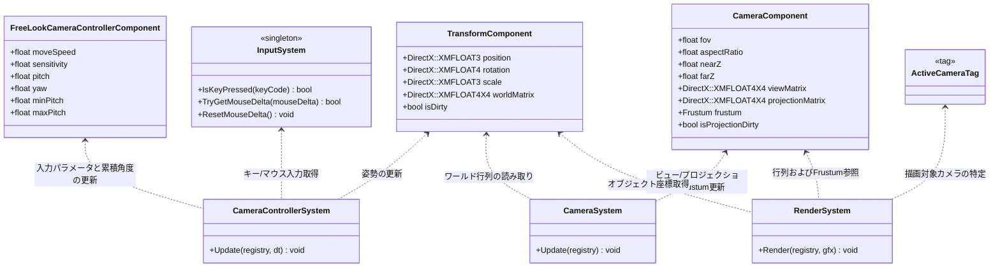
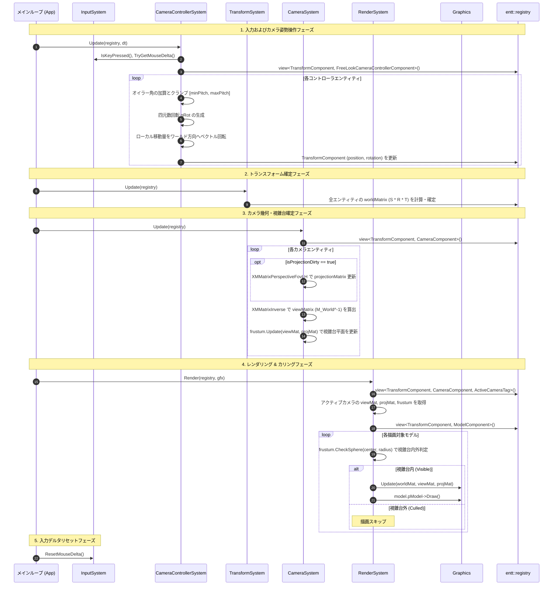

# 演習20 カメラ & カメラコントローラ ECS 化システム: アーキテクチャ設計書

本書は、DirectX 11 エンジンにおけるカメラおよびカメラコントローラの ECS（Entity Component System: EnTT）アーキテクチャへの移行設計、データモデル、パイプライン実行順序、数学的変換モデルについて記述した設計仕様書である。

---

## 1. クラス設計 (システム・アーキテクチャ)

本システムは、**単一責任の原則 (SRP)** および **データ指向設計 (Data-Oriented Design: DOD)** に基づき、カメラの「姿勢データ」「投影・視錐台データ」「コントローラパラメータ」「アクティブカメラ識別タグ」、およびこれらを処理する各システムに責務を完全に分離している。



### 1.1. コンポーネント定義
*   [TransformComponent](file:///d:/DirectX11_Sample/DirextX11Engine/Components.h#L11-L20): カメラのワールド空間における 3D 姿勢（位置・四元数回転・スケール）およびワールド変換行列を保持する。すべての空間エンティティ共通の単一情報源（SSOT）である。
*   [CameraComponent](file:///d:/DirectX11_Sample/DirextX11Engine/Components.h#L22-L37): 視野角（FOV）、アスペクト比、クリップ面距離、ならびに計算済みのビュー行列（`viewMatrix`）、透視投影行列（`projectionMatrix`）、視錐台カリング境界（`frustum`）を保持する。
*   [FreeLookCameraControllerComponent](file:///d:/DirectX11_Sample/DirextX11Engine/Components.h#L39-L51): 自由視点操作における並進速度、マウス回転感度、累積オイラー角（`pitch`, `yaw`）、および上下反転防止のためのクランプ境界（`minPitch`, `maxPitch`）を保持する。
*   [ActiveCameraTag](file:///d:/DirectX11_Sample/DirextX11Engine/Components.h#L53-L54): シーン内でメイン描画（ビューポートレンダリング）の基準となるアクティブカメラエンティティを識別するための空構造体タグ。

### 1.2. システム定義
*   [CameraControllerSystem](file:///d:/DirectX11_Sample/DirextX11Engine/CameraControllerSystem.h#L6-L12): 入力デバイス（マウス・キーボード）の状態を読み取り、`FreeLookCameraControllerComponent` の累積オイラー角および `TransformComponent` の位置・回転クォータニオンを更新する。
*   [CameraSystem](file:///d:/DirectX11_Sample/DirextX11Engine/CameraSystem.h#L6-L12): `TransformComponent` の確定したワールド行列から逆行列変換によってビュー行列を構築し、プロジェクション行列および視錐台（`Frustum`）を更新する。
*   [RenderSystem](file:///d:/DirectX11_Sample/DirextX11Engine/RenderSystem.h#L9-L13): `ActiveCameraTag` を持つカメラエンティティからビュー・プロジェクション行列および Frustum を取得し、各モデルの視錐台カリング判定と GPU への描画コマンド発行を行う。

---

## 2. 処理フロー (シーケンス図)

毎フレームの実行パイプラインにおいて、データの依存関係に基づく決定論的な実行順序（Execution Order）が厳密に保証される。



---

## 3. 数学的モデルと変換アルゴリズム

### 3.1. 自由視点カメラの姿勢変換 (Euler to Quaternion)
コントローラはマウスの累積変位からオイラー角（Pitch, Yaw）を保持し、以下の数式によって四元数回転 $\mathbf{q}$ へ変換する。

$$\mathbf{q} = \mathbf{q}_{\text{yaw}} \otimes \mathbf{q}_{\text{pitch}}$$

ここで、ピッチ角 $\theta_p$ はジンバルロックおよび上下反転を回避するため、以下の不変条件制約を満たす。

$$\theta_{\min} \le \theta_p \le \theta_{\max} \quad \left( -\frac{\pi}{2} + \epsilon \le \theta_p \le \frac{\pi}{2} - \epsilon \right)$$

### 3.2. ローカル移動ベクトルのワールド空間変換
キーボード入力から生成されたローカル移動ベクトル $\mathbf{v}_{\text{local}} = (x, y, z, 0)^T$ は、カメラの回転四元数 $\mathbf{q}$ を用いたクォータニオン回転作用によりワールド移動ベクトル $\mathbf{v}_{\text{world}}$ に変換される。

$$\mathbf{v}_{\text{world}} = \mathbf{q} \otimes \mathbf{v}_{\text{local}} \otimes \mathbf{q}^*$$

### 3.3. ビュー変換行列 (View Matrix) の数学的定義
ビュー行列 $\mathbf{M}_{\text{View}}$ は、ワールド空間座標をカメラ視点座標系へ移すアフィン変換行列であり、カメラのワールド行列 $\mathbf{M}_{\text{World}}$ の逆行列として定義される。

$$\mathbf{M}_{\text{View}} = \mathbf{M}_{\text{World}}^{-1}$$

カメラのワールド行列が回転 $\mathbf{R}$ と平行移動 $\mathbf{T}$ のみ（拡大縮小 $\mathbf{S} = \mathbf{I}$）で構成される場合、直交行列の性質 $\mathbf{R}^{-1} = \mathbf{R}^T$ より以下のように展開される。

$$\mathbf{M}_{\text{World}} = \begin{bmatrix} \mathbf{R} & \mathbf{0} \\ \mathbf{t} & 1 \end{bmatrix} \implies \mathbf{M}_{\text{View}} = \begin{bmatrix} \mathbf{R}^T & \mathbf{0} \\ -\mathbf{t}\mathbf{R}^T & 1 \end{bmatrix}$$

### 3.4. 左手系透視投影行列 (Perspective Projection Matrix)
DirectX 11 の正規化デバイス座標系（NDC: $x \in [-1, 1], y \in [-1, 1], z \in [0, 1]$）に基づく透視投影行列 $\mathbf{M}_{\text{Proj}}$ は以下の通りである。

$$\mathbf{M}_{\text{Proj}} = \begin{bmatrix} \frac{1}{\text{aspect} \cdot \tan\left(\frac{\text{fov}}{2}\right)} & 0 & 0 & 0 \\ 0 & \frac{1}{\tan\left(\frac{\text{fov}}{2}\right)} & 0 & 0 \\ 0 & 0 & \frac{f}{f - n} & 1 \\ 0 & 0 & -\frac{n \cdot f}{f - n} & 0 \end{bmatrix}$$

*   $\text{fov}$: 垂直視野角 (Field of View) [rad]
*   $\text{aspect}$: アスペクト比 ($\text{Width} / \text{Height}$)
*   $n$: 近クリップ面距離 (Near Z)
*   $f$: 遠クリップ面距離 (Far Z)

---

## 4. 定数バッファと HLSL メモリレイアウト

`RenderSystem` はアクティブカメラの行列と各エンティティのワールド行列を GPU の定数バッファ（Constant Buffer: `register(b0)`）へ転送する。

### 4.1. C++ 側定数バッファ構造体
```cpp
// HLSL 16バイト境界アライメントに準拠
struct ConstantBuffer
{
    DirectX::XMMATRIX mWorld;      // 64 bytes
    DirectX::XMMATRIX mView;       // 64 bytes
    DirectX::XMMATRIX mProjection; // 64 bytes
};
```

### 4.2. HLSL 側シェーダー定義 (`PBRVertexShader.hlsl`)
```hlsl
cbuffer ConstantBuffer : register(b0)
{
    matrix World;
    matrix View;
    matrix Projection;
};

struct VS_INPUT
{
    float3 Pos : POSITION;
    float3 Normal : NORMAL;
    float2 TexCoord : TEXCOORD;
};

struct VS_OUTPUT
{
    float4 Pos : SV_POSITION;
    float3 WorldPos : POSITION;
    float3 Normal : NORMAL;
    float2 TexCoord : TEXCOORD;
};

VS_OUTPUT VSMain(VS_INPUT input)
{
    VS_OUTPUT output;
    float4 worldPos = mul(float4(input.Pos, 1.0f), World);
    output.WorldPos = worldPos.xyz;
    output.Pos = mul(mul(worldPos, View), Projection);
    output.Normal = mul(input.Normal, (float3x3)World);
    output.TexCoord = input.TexCoord;
    return output;
}
```

---

## 5. 専門用語集 (Glossary)

1. **ECS (Entity Component System)**
   識別子である Entity、純粋なデータを保持する Component、データの走査と反復処理を行う System を厳密に分離するアーキテクチャパターン。オブジェクト指向の継承による肥大化を解消し、高い保守性とデータ局所性を実現する。
2. **DOD (Data-Oriented Design / データ指向設計)**
   コードの抽象化や振る舞いではなく、データのメモリ上での配置とキャッシュ効率、データ変換の流れを中心に据えて設計するパラダイム。
3. **SSOT (Single Source of Truth / 信頼できる唯一の情報源)**
   データの二重保持や不整合を防ぐため、特定状態の正規データ（真の値）を一箇所のみで所有・管理する原則。本設計ではカメラの姿勢データを `TransformComponent` に一元化している。
4. **Frustum Culling (視錐台カリング)**
   カメラの視錐台（描画可能領域）の外側に位置するオブジェクトを、ジオメトリ描画パイプラインへ送信する前にバウンディングスフィアや AABB の交差判定によって除外し、GPU 描画負荷を低減する最適化技術。
5. **Gimbal Lock (ジンバルロック)**
   オイラー角においてピッチ角が $\pm 90^\circ$ に達した際、Yaw 軸と Roll 軸が同一平面上に重なり、回転の自由度が 1 軸消失する幾何学的特異点。本システムではオイラー角のピッチ角を $[-\pi/2 + \epsilon, \pi/2 - \epsilon]$ に制限することでこれを完全に防止している。