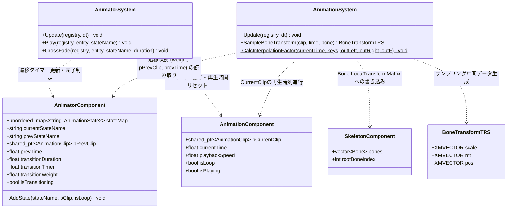
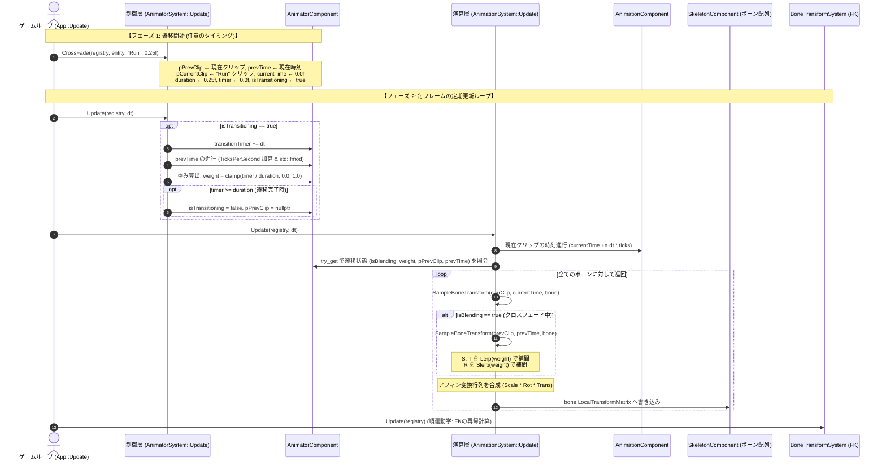
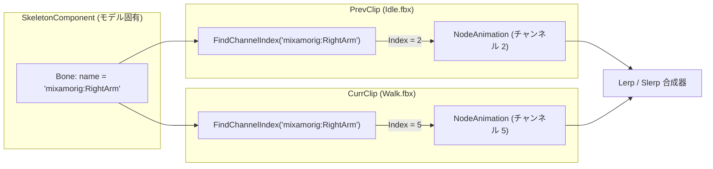

# 演習21 アニメーション・クロスフェード (Animation CrossFade) システム: アーキテクチャ設計書

本ドキュメントは、DirectX 11 ゲームエンジンおよび ECS (Entity Component System: EnTT) 環境における、2つのアニメーションクリップ間を滑らかに補間・遷移させる「アニメーション・クロスフェード (CrossFade) システム」のアーキテクチャ設計、数学的モデル、およびメモリレイアウトについて説明する設計仕様書である。

---

## 1. クラス設計 (システム・アーキテクチャ)

本システムは、**単一責任の原則 (SRP: Single Responsibility Principle)** および **単一書き込み権限 (Single Writer Principle)** に基づき、高レベルな状態遷移・タイマー制御を担う「制御層 (`AnimatorSystem`)」と、キーフレーム抽出・幾何補間演算を担う「演算層 (`AnimationSystem`)」に責務を完全分離している。

### クラスおよび構造体の責務定義
1. **[Components.h: AnimatorComponent](file:///d:/DirectX11_Sample/DirextX11Engine/Components.h)**:
   * 登録されたステート一覧（`stateMap`）および現在のステート名・直前のステート名を管理。
   * 遷移に必要なタイマー（`transitionTimer`）、所要時間（`transitionDuration`）、フェードアウト対象クリップ（`pPrevClip`）、および正規化重み（`transitionWeight`）を保持。
2. **[Components.h: AnimationComponent](file:///d:/DirectX11_Sample/DirextX11Engine/Components.h)**:
   * 現在アクティブなクリップ（`pCurrentClip`）の再生時刻（`currentTime`）、再生速度、ループフラグ等の低レベル再生状態を保持。
3. **[AnimatorSystem.h](file:///d:/DirectX11_Sample/DirextX11Engine/AnimatorSystem.h) / [AnimatorSystem.cpp](file:///d:/DirectX11_Sample/DirextX11Engine/AnimatorSystem.cpp)**:
   * `CrossFade` API を提供し、新旧クリップの入れ替えと遷移パラメータの初期化を実行。
   * 毎フレームの `Update` において遷移タイマーをインクリメントし、重み $t \in [0, 1]$ を正規化計算して完了時にクリーンアップを行う。
4. **[AnimationSystem.h](file:///d:/DirectX11_Sample/DirextX11Engine/AnimationSystem.h) / [AnimationSystem.cpp](file:///d:/DirectX11_Sample/DirextX11Engine/AnimationSystem.cpp)**:
   * ボーン行列（`bone.LocalTransformMatrix`）を更新する唯一のシステム。
   * `AnimatorComponent` の遷移フラグを監視し、非遷移時は単一サンプリング、遷移中は 2 クリップをサンプリングして Lerp / Slerp 合成を行う。

---

## 2. 処理フロー (シーケンス図)

毎フレームのゲームループにおいて、`AnimatorSystem` と `AnimationSystem` がどのように連携してデータをパイプライン処理するかを示す。

---

## 3. 数学的補間モデル (Mathematical Formulation)

クロスフェードにおけるボーン姿勢の補間は、3次元アフィン変換の各成分（拡大縮小・回転・平行移動）に対して独立した幾何学的補間を適用する。

### 3.1. 正規化遷移重み (Normalized Transition Weight)
遷移開始からの経過時間 $T_{\text{timer}}$ および目標遷移時間 $T_{\text{duration}}$ から、クランプされた重み係数 $t$ を算出する：

$$t = \text{std::clamp}\left( \frac{T_{\text{timer}}}{T_{\text{duration}}}, 0.0, 1.0 \right) \quad (T_{\text{duration}} > 0)$$

* $t = 0.0$: 100% 直前のアニメーション姿勢（フェードアウト前）。
* $t = 1.0$: 100% 新しいアニメーション姿勢（フェードイン完了）。

### 3.2. 平行移動ベクトルおよび拡大縮小ベクトルの線形補間 (Lerp)
3次元ベクトル空間 $\mathbb{R}^3$ における平行移動 $\mathbf{P} \in \mathbb{R}^3$ および拡大縮小 $\mathbf{S} \in \mathbb{R}^3$ は、**線形補間 (Linear Interpolation: Lerp)** によって合成される：

$$\mathbf{P}_{\text{final}}(t) = (1 - t) \mathbf{P}_{\text{prev}} + t \mathbf{P}_{\text{curr}} = \mathbf{P}_{\text{prev}} + t (\mathbf{P}_{\text{curr}} - \mathbf{P}_{\text{prev}})$$

$$\mathbf{S}_{\text{final}}(t) = (1 - t) \mathbf{S}_{\text{prev}} + t \mathbf{S}_{\text{curr}} = \mathbf{S}_{\text{prev}} + t (\mathbf{S}_{\text{curr}} - \mathbf{S}_{\text{prev}})$$

### 3.3. 回転四元数の球面線形補間 (Slerp)
3次元回転を表す単位四元数（Unit Quaternion） $\mathbf{q}_{\text{prev}}, \mathbf{q}_{\text{curr}} \in \mathbb{H}$ （$\|\mathbf{q}\| = 1$）の補間には、角速度を一定に保ち最短の回転弧を通過する **球面線形補間 (Spherical Linear Interpolation: Slerp)** を採用する：

$$\mathbf{q}_{\text{final}}(t) = \frac{\sin((1 - t)\theta)}{\sin\theta} \mathbf{q}_{\text{prev}} + \frac{\sin(t\theta)}{\sin\theta} \mathbf{q}_{\text{curr}}$$

ここで、2つの四元数の内積から回転角 $\theta$ を求める：
$$\cos\theta = \mathbf{q}_{\text{prev}} \cdot \mathbf{q}_{\text{curr}} = w_1 w_2 + x_1 x_2 + y_1 y_2 + z_1 z_2$$

> [!NOTE]
> 四元数の二重被覆性（Double Cover: $\mathbf{q}$ と $-\mathbf{q}$ は幾何学的に同一の回転を表す）により、$\cos\theta < 0$ となる場合は最短経路を取るために $\mathbf{q}_{\text{curr}}$ の符号を反転（$-\mathbf{q}_{\text{curr}}$）させた上で補間計算を行う。DirectXMath の `XMQuaternionSlerp` はこの最短経路処理を内部で自動処理する。

### 3.4. 最終ローカル変換行列の構築
合成された $\mathbf{S}_{\text{final}}, \mathbf{q}_{\text{final}}, \mathbf{P}_{\text{final}}$ から、各ボーンのローカル座標系アフィン変換行列 $\mathbf{M}_{\text{local}}$ を生成する：

$$\mathbf{M}_{\text{local}} = \mathbf{M}_{\text{Scale}}(\mathbf{S}_{\text{final}}) \cdot \mathbf{M}_{\text{Rotation}}(\mathbf{q}_{\text{final}}) \cdot \mathbf{M}_{\text{Translation}}(\mathbf{P}_{\text{final}})$$

---

## 4. データ構造とチャンネル解決の安全性設計

異なる FBX アセット間でボーン順序やチャンネル数が異なる問題に対し、本アーキテクチャでは以下の防壁を構築している。

1. **クリップ非依存の安全な名前解決**:
   * ボーン構造体側に単一クリップ用の `animChannelIndex` を固定キャッシュさせず、`SampleBoneTransform` 内部で渡されたクリップから `clip->FindChannelIndex(bone.name)` を都度安全に取得する。
2. **存在しないボーンの縮退保証 (Graceful Degradation)**:
   * 片方のアニメーションにしか含まれないボーン（例: 指先のボーン、武器の装飾ボーン）が存在する場合、チャンネルインデックスが負値（`-1`）となり、初期バインド姿勢（`defaultScale`, `defaultRot`, `defaultPos`）が自動適用され、配列外アクセス（Out of Range）を未然に防止する。

---

## 5. 専門用語集

* **クロスフェード (CrossFade)**:
  直前のアニメーションの不透明度（影響度）を $1 \to 0$ へ減衰させ、新しいアニメーションの影響度を $0 \to 1$ へ増加させながら重ね合わせることで、姿勢の瞬間的な飛び（ポーズジャンプ）を防止する技術。
* **球面線形補間 (Slerp: Spherical Linear Interpolation)**:
  4次元超球面上において、2つの単位四元数の間を角速度一定で滑らかに回転補間するアルゴリズム。
* **モーメンタム (Momentum / 慣性の維持)**:
  前のアニメーションがフェードアウトする間、そのクリップの再生時刻（`prevTime`）も同時に進め続けることで、歩行や走行の動作の勢いを失わずに滑らかに遷移させる手法。
* **単一書き込み権限 (Single Writer Principle)**:
  ECS アーキテクチャにおいて、特定のコンポーネント（ここでは `SkeletonComponent` のボーン行列）を変更・更新する責任を単一のシステム（`AnimationSystem`）のみに限定する設計原則。
