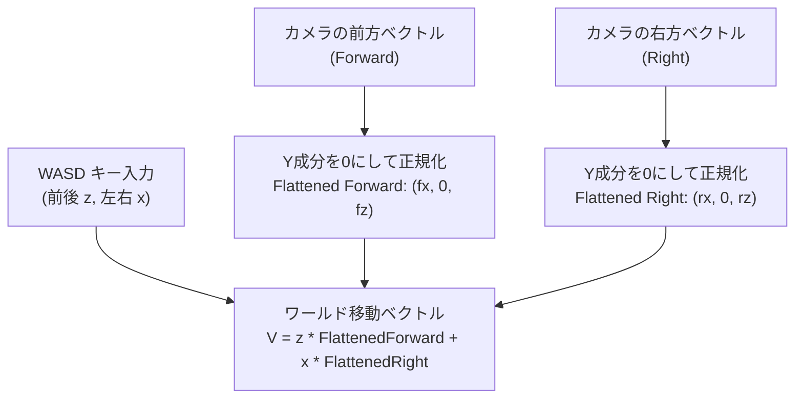
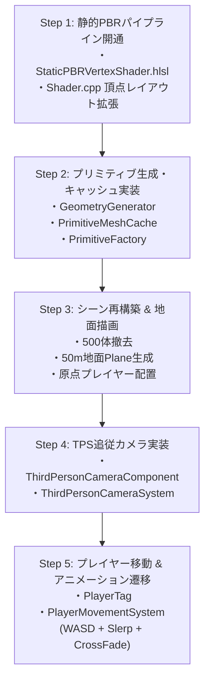

# フリーフロー・コンバット フェーズ1 詳細実装計画書
## （シーン再構築・プリミティブ生成・プレイヤー移動・TPSカメラ）

---

## 1. 概要と目的 (Overview & Objectives)

本ドキュメントは、[Document/FreeflowCombat_Roadmap.md](file:///d:/DirectX11_Sample/DirextX11Engine/Document/FreeflowCombat_Roadmap.md) における「**Phase 1: シーン再構築 ＋ プレイヤー移動 ＋ TPSカメラ**」を完全に達成するための詳細な実装計画書である。

これまでに策定された全体ロードマップ（詳細設計版）の Phase 1 要件と、地面描画のために設計・着手された「Unity風プリミティブオブジェクト生成システム（`GeometryGenerator`, `PrimitiveMeshCache`, `PrimitiveFactory`）」を統合し、単一の明確な実装計画として定義する。

### 1.1. 解決するギャップ一覧

| 識別子 | ギャップ項目 | 重要度 | 解決アプローチ |
|---|---|---|---|
| **G1** | **シーン構成の変更** | 必須 | `App::InitGeometry` 内の 500 体ランダム生成を撤去し、プレイヤー 1 体 ＋ 地面プレーン ＋ デバッグ用プリミティブの構成に移行する。 |
| **G2** | **可視的な地面メッシュ** | 必須 | Unityの `GameObject.CreatePrimitive(PrimitiveType::Plane)` 相当の基盤を構築し、50m × 50m の地面を $(0, 0, 0)$ に生成・描画する。 |
| **G3** | **プレイヤー識別** | 必須 | エンティティからプレイヤーを一意にクエリできる軽量なタグコンポーネント `PlayerTag` を定義・付与する。 |
| **G4** | **カメラ相対の移動制御** | 必須 | TPSカメラの水平前方・右方ベクトルを基準に WASD 移動ベクトルを算出し、キャラクターを移動方向へクォータニオン Slerp で滑らかに旋回させつつ、速度に応じて `Idle` $\leftrightarrow$ `Walk` $\leftrightarrow$ `Run` をクロスフェード再生する。 |
| **G5** | **三人称追従カメラ (TPS)** | 必須 | プレイヤーを注視点とするオービットカメラコンポーネント `ThirdPersonCameraComponent` と、マウスデルタ入力から球面座標系でカメラ位置を算出する `ThirdPersonCameraSystem` を実装する。 |

---

## 2. システムアーキテクチャ (Architecture Overview)

フェーズ1で構築するサブシステム群と、既存の DirectX 11 / ECS 基盤との相互接続関係を以下に示す。

```mermaid
graph TD
    subgraph Input Layer
        IS["InputSystem<br/>(WASD入力, マウスデルタ)"]
    end

    subgraph Primitive Generation & Resource Cache (G2)
        GG["GeometryGenerator<br/>(数学的頂点/インデックス生成)"]
        PMC["PrimitiveMeshCache<br/>(ModelAsset の形状別共有キャッシュ)"]
        PF["PrimitiveFactory<br/>(CreatePrimitive API)"]
        SPBR["StaticPBRVertexShader.hlsl<br/>(静的メッシュ用頂点シェーダー)"]
    end

    subgraph ECS Scene Architecture (G1, G3)
        Ground["Ground Entity<br/>(Transform + ModelAsset[Plane] + Material)"]
        Player["Player Entity<br/>(Transform + SkinnedModel + Animator + PlayerTag)"]
        Camera["Camera Entity<br/>(Transform + Camera + ThirdPersonCameraComponent)"]
    end

    subgraph Gameplay & Camera Systems (G4, G5)
        TPCS["ThirdPersonCameraSystem<br/>(マウスデルタ → 球面座標計算 → カメラTransform更新)"]
        PMS["PlayerMovementSystem<br/>(カメラ相対WASD → 移動/旋回Slerp → CrossFade)"]
    end

    subgraph Rendering Pipeline
        AnimSys["AnimatorSystem / AnimationSystem<br/>(ボーン行列計算 & パレット転送)"]
        CullSys["CullingSystem<br/>(視錐台カリング & LOD)"]
        RenderSys["RenderSystem<br/>(Static / Skinned PBR描画)"]
    end

    IS -->|マウスデルタ| TPCS
    IS -->|WASDキー| PMS
    
    GG --> PMC
    PMC --> PF
    SPBR -.-> PF
    PF --> Ground

    TPCS -->|更新| Camera
    Camera -.->|注視点参照| Player
    Camera -.->|カメラ向き参照| PMS

    PMS -->|移動 & 旋回| Player
    PMS -->|CrossFade要求| AnimSys
    
    Player --> AnimSys
    Ground --> RenderSys
    Player --> RenderSys
    Camera --> CullSys
    CullSys --> RenderSys
```

---

## 3. サブシステム1: 静的プリミティブ生成・レンダリング基盤 (G2 解決)

### 3.1. 静的頂点シェーダーと入力レイアウトの分離

*   **課題**: 既存の `PBRVertexShader.hlsl` はキャラクター用の `SkinnedVertex`（92バイト：ボーンID・ウェイト含む）固定となっており、地面やキューブなどの静的ジオメトリをそのまま描画できない。
*   **解決策**:
    1.  静的メッシュ用の頂点シェーダー [`Shaders/StaticPBRVertexShader.hlsl`](file:///d:/DirectX11_Sample/DirextX11Engine/Shaders/StaticPBRVertexShader.hlsl) を導入する。
    2.  `Vertex` 構造体（48バイト：Position, Normal, Tangent, Color, TexCoord）に対応する `ID3D11InputLayout` を作成する。
    3.  既存の [`PBRPixelShader.hlsl`](file:///d:/DirectX11_Sample/DirextX11Engine/Shaders/PBRPixelShader.hlsl) と同一の `PS_INPUT` 構造体を出力することで、PBRライティングパイプライン（金属度、粗さ、ディレクショナルライト計算）を共用する。

#### HLSL 頂点シェーダーの入出力定義
```hlsl
// 入力: 静的頂点 (48バイト)
struct VS_INPUT
{
    float3 Position : POSITION;
    float3 Normal   : NORMAL;
    float3 Tangent  : TANGENT;
    float4 Color    : COLOR;
    float2 TexCoord : TEXCOORD0;
};

// 出力: ピクセルシェーダー入力 (PBRPixelShader.hlsl と完全一致)
struct PS_INPUT
{
    float4 Position : SV_POSITION;
    float3 WorldPos : POSITION;
    float3 Normal   : NORMAL;
    float3 Tangent  : TANGENT;
    float4 Color    : COLOR;
    float2 TexCoord : TEXCOORD0;
};
```

### 3.2. 形状生成エンジン ([GeometryGenerator](file:///d:/DirectX11_Sample/DirextX11Engine/Model/GeometryGenerator.h))

数学的アルゴリズムに基づき、頂点バッファ・インデックスバッファの元データを生成する。

```cpp
namespace Engine
{
    struct MeshData
    {
        std::vector<Vertex> Vertices;
        std::vector<WORD>   Indices;
    };

    class GeometryGenerator
    {
    public:
        // 平面（地面）: 幅, 奥行き, グリッド分割数 m×n, UVタイリング数
        static MeshData CreatePlane(float width, float depth, uint32_t m, uint32_t n, float uvTilingX, float uvTilingY);
        // 立方体: 幅, 高さ, 奥行き
        static MeshData CreateCube(float width, float height, float depth);
        // 球体: 半径, スライス数, スタック数
        static MeshData CreateSphere(float radius, uint32_t sliceCount, uint32_t stackCount);
        // 円柱: 下底半径, 上底半径, 高さ, スライス数, スタック数
        static MeshData CreateCylinder(float bottomRadius, float topRadius, float height, uint32_t sliceCount, uint32_t stackCount);
    };
}
```

*   **UVタイリング対応**: 地面プレーン（50m×50m）において、テクスチャが引き伸ばされるのを防ぐため、`uvTilingX = 50.0f`, `uvTilingY = 50.0f` 等のタイリング引数をサポートする。
*   **バウンディングスフィア算出**: 生成した頂点配列の `Pos` 要素から `DirectX::BoundingSphere::CreateFromPoints` を呼び出し、視錐台カリング用の局所境界球を正確に初期化する。

### 3.3. 形状別リソースキャッシュ ([PrimitiveMeshCache](file:///d:/DirectX11_Sample/DirextX11Engine/Model/PrimitiveMeshCache.h))

プリミティブエンティティを複数生成する際、形状ごとに頂点バッファ・インデックスバッファ（`ModelAsset`）を重複生成しないようキャッシュ管理する。

```cpp
namespace Engine
{
    class PrimitiveMeshCache
    {
    public:
        std::shared_ptr<ModelAsset> GetOrCreatePlane(ID3D11Device* pDevice, float width, float depth, uint32_t m, uint32_t n, float uvTilingX, float uvTilingY);
        std::shared_ptr<ModelAsset> GetOrCreateCube(ID3D11Device* pDevice, float width, float height, float depth);
        std::shared_ptr<ModelAsset> GetOrCreateSphere(ID3D11Device* pDevice, float radius, uint32_t sliceCount, uint32_t stackCount);
        std::shared_ptr<ModelAsset> GetOrCreateCylinder(ID3D11Device* pDevice, float bottomRadius, float topRadius, float height, uint32_t sliceCount, uint32_t stackCount);

    private:
        std::shared_ptr<ModelAsset> CreateModelAssetFromMeshData(ID3D11Device* pDevice, const MeshData& meshData);

        std::unordered_map<std::string, std::shared_ptr<ModelAsset>> m_cache;
    };
}
```

### 3.4. Unity風エンティティ生成ファクトリ ([PrimitiveFactory](file:///d:/DirectX11_Sample/DirextX11Engine/Model/PrimitiveFactory.h))

Unity の `GameObject.CreatePrimitive` 相当の 1 行呼び出しインターフェースを提供する。

```cpp
namespace Engine
{
    enum class PrimitiveType
    {
        Plane,
        Cube,
        Sphere,
        Cylinder
    };

    class PrimitiveFactory
    {
    public:
        static void Initialize(
            Graphics* pGfx,
            std::shared_ptr<Shader> pStaticShader,
            std::shared_ptr<Texture> pDefaultTexture
        );

        static entt::entity CreatePrimitive(
            entt::registry& registry,
            PrimitiveType type,
            const DirectX::XMFLOAT3& position = { 0.0f, 0.0f, 0.0f },
            const DirectX::XMFLOAT3& scale = { 1.0f, 1.0f, 1.0f },
            const DirectX::XMFLOAT4& baseColor = { 1.0f, 1.0f, 1.0f, 1.0f }
        );
    };
}
```

---

## 4. サブシステム2: シーン再構築とプレイヤー識別 (G1, G3 解決)

### 4.1. シーン再構築（[`App::InitGeometry`](file:///d:/DirectX11_Sample/DirextX11Engine/App/App.cpp) の改修）

*   **既存ループの撤去**: 乱数で 500 体をばら撒く `for (int i = 0; i < 500; ++i)` ループを削除する。
*   **地面プレーンの生成**:
    ```cpp
    // 50m × 50m の地面を原点に配置
    PrimitiveFactory::CreatePrimitive(
        m_registry,
        PrimitiveType::Plane,
        DirectX::XMFLOAT3(0.0f, 0.0f, 0.0f),
        DirectX::XMFLOAT3(1.0f, 1.0f, 1.0f),
        DirectX::XMFLOAT4(0.4f, 0.4f, 0.4f, 1.0f) // 視認性の高いダークグレー
    );
    ```
*   **プレイヤーの生成**:
    - 原点 $(0, 0, 0)$ に SwordMan モデルのエンティティを 1 体のみ生成。
    - `TransformComponent`（初期座標 $0, 0, 0$）、`ModelAsset`（SwordMan）、`AnimatorComponent` を付与。
    - `PlayerTag` を付与。

### 4.2. プレイヤー識別タグコンポーネント

```cpp
// ECS/Components.h
struct PlayerTag {};
```

---

## 5. サブシステム3: 三人称追従カメラ (TPS) (G5 解決)

### 5.1. コンポーネント設計

既存のデバッグ用フリーカメラ（`FreeLookCameraControllerComponent`）から独立させ、三人称視点専用の追従コンポーネントを定義する。

```cpp
// ECS/Components.h
struct ThirdPersonCameraComponent
{
    entt::entity targetEntity = entt::null; // 追従対象（PlayerTagを持つエンティティ）
    
    float armLength    = 6.0f;  // カメラと注視点の距離 (メートル)
    float heightOffset = 1.6f;  // プレイヤーの足元からの注視点高さ（胸〜頭の高さ）
    
    float pitch = 0.25f;        // 垂直仰角 (rad) - 約 15° 見下ろし
    float yaw   = 0.0f;         // 水平方位角 (rad)
    
    float minPitch = -0.5f;     // 見上げ限界 (約 -28°)
    float maxPitch =  1.3f;     // 見下ろし限界 (約 +75°)
    
    float rotateSensitivity = 0.003f; // マウス感度
    float zoomSensitivity   = 0.5f;   // ホイールズーム感度（将来拡張）
};
```

### 5.2. 球面座標系によるカメラ座標計算アルゴリズム

注視点座標 $\mathbf{P}_{\text{focus}}$ を基準とし、球面座標系 $(\rho, \theta, \phi)$ からデカルト座標系への変換を行う。

$$
\mathbf{P}_{\text{focus}} = \mathbf{P}_{\text{player}} + \begin{pmatrix} 0 \\ \text{heightOffset} \\ 0 \end{pmatrix}
$$

$$
\mathbf{P}_{\text{cam}} = \mathbf{P}_{\text{focus}} + \begin{pmatrix}
\text{armLength} \cdot \cos(\text{pitch}) \cdot \sin(\text{yaw}) \\
\text{armLength} \cdot \sin(\text{pitch}) \\
\text{armLength} \cdot \cos(\text{pitch}) \cdot \cos(\text{yaw})
\end{pmatrix}
$$

```cpp
// Camera/ThirdPersonCameraSystem.cpp
void ThirdPersonCameraSystem::Update(entt::registry& registry, const InputSystem& input, float deltaTime)
{
    auto view = registry.view<TransformComponent, CameraComponent, ThirdPersonCameraComponent>();
    for (auto entity : view)
    {
        auto& transform = view.get<TransformComponent>(entity);
        auto& tps = view.get<ThirdPersonCameraComponent>(entity);

        if (!registry.valid(tps.targetEntity)) continue;
        const auto& targetTransform = registry.get<TransformComponent>(tps.targetEntity);

        // 1. マウス入力によるピッチ・ヨー角の更新
        DirectX::XMFLOAT2 mouseDelta = input.GetMouseDelta();
        tps.yaw   += mouseDelta.x * tps.rotateSensitivity;
        tps.pitch -= mouseDelta.y * tps.rotateSensitivity;

        // ピッチ角のクランプ
        tps.pitch = std::clamp(tps.pitch, tps.minPitch, tps.maxPitch);

        // 2. 注視点座標
        DirectX::XMVECTOR targetPos = DirectX::XMLoadFloat3(&targetTransform.position);
        DirectX::XMVECTOR focusPos = DirectX::XMVectorAdd(targetPos, DirectX::XMVectorSet(0.0f, tps.heightOffset, 0.0f, 0.0f));

        // 3. 球面座標からカメラ位置の算出
        float x = tps.armLength * std::cos(tps.pitch) * std::sin(tps.yaw);
        float y = tps.armLength * std::sin(tps.pitch);
        float z = tps.armLength * std::cos(tps.pitch) * std::cos(tps.yaw);
        DirectX::XMVECTOR camPos = DirectX::XMVectorAdd(focusPos, DirectX::XMVectorSet(x, y, z, 0.0f));

        DirectX::XMStoreFloat3(&transform.position, camPos);

        // 4. カメラの向き（クォータニオン）の算出
        DirectX::XMVECTOR forward = DirectX::XMVector3Normalize(DirectX::XMVectorSubtract(focusPos, camPos));
        DirectX::XMVECTOR up = DirectX::XMVectorSet(0.0f, 1.0f, 0.0f, 0.0f);
        DirectX::XMMATRIX viewMatrix = DirectX::XMMatrixLookAtLH(camPos, focusPos, up);
        
        // viewMatrix の逆行列からカメラのワールド回転クォータニオンを抽出
        DirectX::XMVECTOR scale, rotQuat, trans;
        DirectX::XMMatrixDecompose(&scale, &rotQuat, &trans, DirectX::XMMatrixInverse(nullptr, viewMatrix));
        DirectX::XMStoreFloat4(&transform.rotation, rotQuat);
    }
}
```

---

## 6. サブシステム4: カメラ相対移動とアニメーション遷移 (G4 解決)

### 6.1. カメラ相対移動ベクトルの算出

WASD の入力を、TPSカメラの「水平面上における前方・右方ベクトル」に投影してワールド移動ベクトルを合成する。



### 6.2. キャラクター旋回 (Slerp) と移動更新

プレイヤーが移動方向へ急激に瞬間反転するのを防ぎ、クォータニオンの球面線形補間（`XMQuaternionSlerp`）によって滑らかに向きを変える。

$$
\mathbf{q}_{\text{current}} \leftarrow \text{Slerp}(\mathbf{q}_{\text{current}}, \mathbf{q}_{\text{target}}, \text{turnSpeed} \cdot \Delta t)
$$

### 6.3. 移動速度とアニメーション・クロスフェードの連動

入力の強さやShiftキー（スプリント）に応じて、`AnimatorSystem::CrossFade` を呼び出す。

| 状態 | 移動速度 | アニメーション | クロスフェード時間 |
|---|---|---|---|
| 停止（入力なし） | 0.0 m/s | `Idle` | 0.25 秒 |
| 通常移動 (WASD) | 3.5 m/s | `Walk` | 0.20 秒 |
| ダッシュ (WASD + Shift) | 6.5 m/s | `Run` | 0.15 秒 |

```cpp
// PlayerMovementSystem.cpp の制御ロジック概要
if (isMoving)
{
    float currentSpeed = isSprinting ? sprintSpeed : walkSpeed;
    
    // 1. 移動方向への回転目標クォータニオン
    float targetYaw = std::atan2(moveDirX, moveDirZ);
    DirectX::XMVECTOR targetQuat = DirectX::XMQuaternionRotationRollPitchYaw(0.0f, targetYaw, 0.0f);
    
    // 2. Slerp による旋回
    DirectX::XMVECTOR currentQuat = DirectX::XMLoadFloat4(&transform.rotation);
    DirectX::XMVECTOR newQuat = DirectX::XMQuaternionSlerp(currentQuat, targetQuat, turnSpeed * deltaTime);
    DirectX::XMStoreFloat4(&transform.rotation, newQuat);

    // 3. 座標更新 & 接地クランプ (Y = 0)
    transform.position.x += moveDirX * currentSpeed * deltaTime;
    transform.position.z += moveDirZ * currentSpeed * deltaTime;
    transform.position.y = 0.0f;

    // 4. アニメーション切り替え
    std::string targetAnim = isSprinting ? "Run" : "Walk";
    if (currentAnimName != targetAnim)
    {
        animatorComp.CrossFade(targetAnim, isSprinting ? 0.15f : 0.2f);
    }
}
else
{
    // 停止時は Y = 0 固定 & Idle へフェード
    transform.position.y = 0.0f;
    if (currentAnimName != "Idle")
    {
        animatorComp.CrossFade("Idle", 0.25f);
    }
}
```

---

## 7. 実装ステップと作業順序 (Step-by-Step Implementation Roadmap)

各コンポーネントの依存関係に従い、以下の 5 ステップで順次構築する。



### Step 1: 静的PBRレンダリングパイプラインの開通
1. [`Shaders/StaticPBRVertexShader.hlsl`](file:///d:/DirectX11_Sample/DirextX11Engine/Shaders/StaticPBRVertexShader.hlsl) の作成・コンパイル設定確認。
2. [`Graphics/Shader.h`](file:///d:/DirectX11_Sample/DirextX11Engine/Graphics/Shader.h) / [`Graphics/Shader.cpp`](file:///d:/DirectX11_Sample/DirextX11Engine/Graphics/Shader.cpp) に `VertexLayoutType { Static, Skinned }` を導入し、静的頂点（48バイト）用入力レイアウト生成メソッドを実装。

### Step 2: プリミティブ生成エンジンとリソースキャッシュの実装
1. [`Model/GeometryGenerator.cpp`](file:///d:/DirectX11_Sample/DirextX11Engine/Model/GeometryGenerator.cpp) で `CreatePlane`, `CreateCube`, `CreateSphere`, `CreateCylinder` を実装。
2. [`Model/PrimitiveMeshCache.cpp`](file:///d:/DirectX11_Sample/DirextX11Engine/Model/PrimitiveMeshCache.cpp) を完成させ、`MeshData` から `SubMesh` および `BoundingSphere` を含む `ModelAsset` を生成・キャッシュするロジックを実装。
3. [`Model/PrimitiveFactory.cpp`](file:///d:/DirectX11_Sample/DirextX11Engine/Model/PrimitiveFactory.cpp) を完成させ、ECS エンティティの組み立て（`TransformComponent`, `ModelAsset`, `MaterialComponent`, `VisibleTag`）を完結させる。

### Step 3: シーン再構築と地面描画
1. [`App/App.cpp`](file:///d:/DirectX11_Sample/DirextX11Engine/App/App.cpp) で `StaticPBRVertexShader` をロードし、`PrimitiveFactory::Initialize` を実行。
2. `App::InitGeometry` 内の 500 体ランダム生成コードを撤去。
3. `PrimitiveFactory::CreatePrimitive` で 50m × 50m の地面を配置。
4. 原点 $(0, 0, 0)$ に SwordMan プレイヤーを 1 体配置し、ビルドして地面の上にキャラクターが描画されることを確認。

### Step 4: TPS追従カメラの実装
1. [`ECS/Components.h`](file:///d:/DirectX11_Sample/DirextX11Engine/ECS/Components.h) に `ThirdPersonCameraComponent` を定義。
2. [`Camera/ThirdPersonCameraSystem.h`](file:///d:/DirectX11_Sample/DirextX11Engine/Camera/ThirdPersonCameraSystem.h) / `.cpp` を新規作成し、マウス入力による球面座標系カメラ更新を実装。
3. カメラエンティティに `ThirdPersonCameraComponent` を設定（`targetEntity = player`）し、従来の `FreeLookCameraControllerComponent` を無効化。
4. マウス操作でプレイヤーの周囲を滑らかにカメラが旋回・追従することを確認。

### Step 5: カメラ相対移動とアニメーション遷移の実装
1. [`ECS/Components.h`](file:///d:/DirectX11_Sample/DirextX11Engine/ECS/Components.h) に `PlayerTag` を定義。
2. [`ECS/PlayerMovementSystem.h`](file:///d:/DirectX11_Sample/DirextX11Engine/ECS/PlayerMovementSystem.h) / `.cpp` を新規作成。
3. カメラ向き基準の移動ベクトル算出、クォータニオン Slerp 旋回、`position.y = 0.0f` クランプ、および速度に応じた `Idle` ⇄ `Walk` ⇄ `Run` の `CrossFade` を実装。
4. `App::Update` の更新ループに `PlayerMovementSystem` と `ThirdPersonCameraSystem` を組み込む。

---

## 8. 検証計画と合否判定基準 (Verification & Acceptance Criteria)

### 8.1. 自動ビルド検証
*   MSBuild コマンドによるビルド検証:
    ```powershell
    MSBuild.exe DirextX11Engine.sln /p:Configuration=Debug /p:Platform=x64
    ```
*   **合否基準**: コンパイルエラー 0 件、リンクエラー 0 件で正常終了すること。

### 8.2. 目視・操作検証項目 (チェックリスト)

| # | 検証項目 | 操作・手順 | 期待される合格動作 |
|---|---|---|---|
| **V1** | **地面メッシュ描画** | エンジン起動 | 原点中心に広大な平面（Plane）が表示され、PBRライティングによる陰影が反映されていること。 |
| **V2** | **デバッグプリミティブ** | 任意配置の Cube / Sphere 確認 | 歪みなく正確な法線・PBRスペキュラで描画されていること。 |
| **V3** | **TPSカメラ追従** | マウス移動 | マウス水平・垂直移動に合わせてカメラがプレイヤー周囲を旋回し、指定した仰角制限（minPitch〜maxPitch）でクランプされること。 |
| **V4** | **カメラ相対移動** | WASD キー入力 | 常に「画面手前 / 奥 / 左右」のカメラ視線基準でプレイヤーが進行すること。 |
| **V5** | **キャラクター旋回** | 進行方向の変更 | 急反転せず、進行方向へ向けて Slerp で滑らかに体を向けること。 |
| **V6** | **アニメーション遷移** | 移動 $\leftrightarrow$ 停止、Shiftダッシュ | 停止（Idle）から移動で Walk、Shift押しで Run へと足滑りなくスムーズにクロスフェードし、キーを離すと Idle に復帰すること。 |
| **V7** | **接地維持** | 移動中の挙動観察 | プレイヤーの足元が常に地面（$Y = 0$）に接地し、上下に浮遊・沈下しないこと。 |

---

## 9. 専門用語集 (Glossary)

*   **球面座標系 (Spherical Coordinate System)**:
    空間上の位置を、原点からの距離（半径 $r$ またはアーム長）、方位角（Yaw $\theta$）、仰角（Pitch $\phi$）の 3 つのパラメータで表す座標系。注視点を中心とする TPS オービットカメラの算出に最も適している。
*   **Slerp (Spherical Linear Interpolation / 球面線形補間)**:
    単位クォータニオン間を角速度一定で滑らかに回転補間する手法。急激な向きの切り替わりによるアニメーションの不連続・ガタつき（ジャーク）を防止する。
*   **オービットカメラ (Orbit Camera)**:
    特定のターゲット（キャラクター）を常に中心（注視点）に据え、その周囲の球面上を軌道（Orbit）周回する三人称視点カメラ制御方式。
*   **フロアクランプ (Floor Clamp)**:
    物理エンジン（重力・剛体シミュレーション）を導入せずに、毎フレームキャラクターの垂直座標を地表の高さ（$Y = 0$）に強制的に固定・制限する軽量な接地処理。
*   **PBR (Physically Based Rendering / 物理ベースレンダリング)**:
    光の物理的な反射・拡散特性（金属度 Metallic、粗さ Roughness）に基づき、現実世界の光学法則を近似して質感を描画するレンダリング手法。
