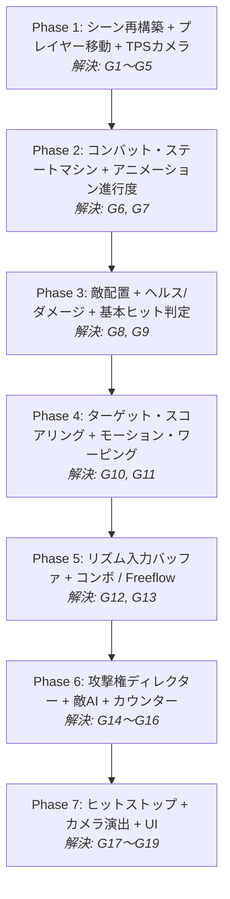

# フリーフロー・コンバット (Freeflow Combat) 実装ロードマップ

本ドキュメントは、現在の DirectX 11 エンジン（演習21: アニメーション・クロスフェード完了時点）を起点として、バットマン アーカムシリーズ風のフリーフロー・コンバットを実装するために「何が不足しているか」と「どの順序で構築するか」を整理したものである。

---

## 1. 現状の資産と不足要素のギャップ分析

### 1.1. 利用可能な既存資産

| カテゴリ | 既存実装 | 備考 |
|---|---|---|
| ECS 基盤 | EnTT による Entity / Component / System 構造 | 新規システムの追加が疎結合に可能 |
| アニメーション再生 | `AnimationSystem` によるキーフレーム補間・ボーン行列算出 | 単一クリップ再生は完成 |
| クロスフェード | `AnimatorSystem::CrossFade` による 2 クリップ間の Lerp/Slerp 合成 | クリップ間のチャンネル安全な名前解決済み |
| ステート管理 | `AnimatorComponent.stateMap` による名前ベースのアニメーション登録 | `AddState` / `Play` / `CrossFade` API |
| アニメーション素材 | Idle, Walk, Run, Slash, Jump, Block Idle, Block2, Impact（全8クリップ） | フリーフロー・コンバットに必要な素材は揃っている |
| 入力システム | `InputSystem` によるキーボード・マウス入力検知 | WASD + マウスデルタ取得可能 |
| 時間管理 | `GameTime::timeScale` によるグローバル時間倍率制御 | ヒットストップに転用可能 |
| カメラ | `FreeLookCameraControllerComponent` による自由視点カメラ | デバッグ用途。ゲーム用 TPS カメラは未実装 |
| カリング / LOD | `CullingSystem` による視錐台カリングと距離ベース LOD | 少数エンティティでもそのまま動作 |
| テキスト描画 | `TextRenderer` による画面上テキスト表示 | コンボ数等の UI に転用可能 |

### 1.2. 不足している要素

| # | 不足要素 | 重要度 | 説明 |
|---|---|---|---|
| G1 | **シーン構成の変更** | 必須 | 現在は 500 体をランダム配置。プレイヤー 1 体 + 敵数体 + 地面に再構成が必要 |
| G2 | **可視的な地面メッシュ** | 必須 | 現在のシーンに地面がなく、空間の把握ができない |
| G3 | **プレイヤー識別** | 必須 | 「どのエンティティがプレイヤーか」を区別する機構がない |
| G4 | **カメラ相対の移動制御** | 必須 | カメラの前方・右方を基準にした WASD 移動とキャラクターの旋回 |
| G5 | **三人称追従カメラ (TPS)** | 必須 | プレイヤーを注視点とするオービットカメラ |
| G6 | **コンバット・ステートマシン** | 必須 | 「今ゲーム上何をしているか」の制御層。行動の許可・禁止・割り込み優先度の管理 |
| G7 | **アニメーション進行度の取得** | 必須 | 攻撃アニメーションの「どの区間にいるか」を外部から参照する手段 |
| G8 | **敵の識別とHP管理** | 必須 | 敵のタグ付け、ヘルスポイント、被弾リアクション |
| G9 | **ヒット判定** | 必須 | 距離 + 角度ベースの攻撃命中判定 |
| G10 | **ターゲット自動選定** | 核心 | 入力方向に基づく最適な攻撃対象の評価・選定 |
| G11 | **突進補間 (モーション・ワーピング)** | 核心 | 攻撃対象の手前まで滑らかに高速移動する吸い付き制御 |
| G12 | **リズム入力バッファ** | 核心 | 連打を罰し、適正タイミングの入力を報酬する機構 |
| G13 | **コンボ / Freeflow 状態管理** | 核心 | 連続ヒットによる突進距離・速度の段階的ブースト |
| G14 | **攻撃権の統括管理 (Combat Director)** | 重要 | 複数の敵が同時に殴りかからないよう攻撃トークンを配分 |
| G15 | **敵の行動 AI** | 重要 | 待機 → 接近 → 攻撃 → スタンの状態遷移 |
| G16 | **カウンター (反撃割り込み)** | 重要 | 敵の攻撃予兆に対する即時反撃と、現在の行動の中断 |
| G17 | **ヒットストップ** | 演出 | 攻撃命中瞬間のコマ止め演出（`GameTime::timeScale` で実現可能） |
| G18 | **カメラ振動** | 演出 | 打撃インパクト時のカメラ震え |
| G19 | **戦闘 UI** | 演出 | コンボカウンター、Freeflow インジケータ |

---

## 2. 実装ステップ（依存関係順）

各フェーズは前のフェーズの成果物に依存している。飛ばして先に進むと検証が困難になる。

---

### Phase 1: シーン再構築 ＋ プレイヤー移動 ＋ TPSカメラ

**解決するギャップ**: G1（シーン構成）、G2（地面）、G3（プレイヤー識別）、G4（移動制御）、G5（TPSカメラ）

**やること**:
1. `App::InitGeometry` の 500 体ランダム生成を撤去し、プレイヤー 1 体を原点に生成する
2. 地面として表示される平面メッシュを追加する（頂点バッファ直接構築 or ローダー経由）
3. プレイヤーを識別するためのタグコンポーネントを定義し付与する
4. TPSオービットカメラを実装する
   - マウスデルタでピッチ・ヨーを操作
   - プレイヤー位置を注視点とし、球面座標系でカメラ位置を算出
   - 既存の `FreeLookCameraControllerComponent` はプレイヤーのカメラエンティティからは外す
5. カメラ相対の WASD 移動を実装する
   - カメラの水平前方ベクトル・右方ベクトルを基準に移動方向を算出
   - 移動方向へキャラクターの回転を Slerp で滑らかに旋回
6. 移動速度に応じて `Idle` ⇄ `Walk` ⇄ `Run` をクロスフェードで切り替える
7. 接地は `position.y = 0` への単純なクランプで十分（重力は不要）

**検証基準**:
- WASD でプレイヤーが地面上を歩ける
- マウスでカメラがプレイヤーの周囲を旋回し追従する
- 移動 / 停止でアニメーションが滑らかに切り替わる

---

### Phase 2: コンバット・ステートマシン ＋ アニメーション進行度

**解決するギャップ**: G6（ステートマシン）、G7（アニメーション進行度）

**なぜ必要か**:
- 現在の `AnimatorComponent` は「どのクリップを再生中か」のみを管理する**アニメーション層**
- フリーフロー・コンバットには「今どの行動が許可されるか・何に割り込めるか」を管理する**ゲームプレイ制御層**が必要
- この2つは責務が異なるため分離すべき

**やること**:
1. ゲームプレイ上の行動ステート（待機 / 攻撃予備動作 / 攻撃インパクト / 攻撃残心 / カウンター / 被弾硬直）を定義する
2. ステートごとの行動制限ルールを設計する
   - 例: 攻撃予備動作中は移動入力を無視する
   - 例: カウンターは攻撃中でも割り込み可能（最高優先度）
3. アニメーションの正規化進行度（`currentTime / duration` → $0.0 \sim 1.0$）を取得できるようにする
4. 正規化進行度に基づいて、攻撃アニメーション内のフェーズ自動遷移（予備動作 → インパクト → 残心）を行うシステムを作る
5. 攻撃入力（左クリック）で `Slash` を再生し、終了後に `Idle` へ自動復帰する流れを組む

**設計上の注意点**:
- 攻撃アニメーションの区間分割は、正規化時間の固定閾値（例: 0.0〜0.3 / 0.3〜0.6 / 0.6〜1.0）で始める
- 将来的にはクリップごとに閾値を変えられるようデータ化するのが望ましい

**検証基準**:
- 左クリックで攻撃モーションが再生され、終了後に Idle に戻る
- 攻撃中に WASD を押しても移動しない
- デバッグログ等で攻撃の各フェーズ（予備動作 / インパクト / 残心）の遷移を確認できる

---

### Phase 3: 敵配置 ＋ ヘルス/ダメージ ＋ 基本ヒット判定

**解決するギャップ**: G8（敵の識別とHP）、G9（ヒット判定）

**なぜこの順序か**:
- 「殴ったら敵が反応する」というフィードバックループは、突進（Phase 4）やコンボ（Phase 5）より先に確立すべき
- この段階では「プレイヤーが自分で近づいて殴る」だけで十分

**やること**:
1. プレイヤーの周囲（半径 4〜7m の円周上）に 4〜6 体の敵エンティティを固定位置に配置する
   - 同じ `SwordMan.fbx` を使用し、`Idle` を再生
   - 敵を識別するタグコンポーネントを付与
2. HP を管理するコンポーネントを定義する（現在HP、最大HP、被弾後の無敵時間）
3. ヒット判定システムを実装する
   - 物理コライダは不要。**距離 + 角度** の条件で判定する
   - 条件: プレイヤーとの距離が打撃間合い以内（例: 2.5m）**かつ** プレイヤー正面方向と敵への方向のなす角が一定範囲内（例: ±60°）
   - 判定タイミング: 攻撃ステートが「インパクト」フェーズに入った瞬間（Phase 2 のステートマシンと連動）
4. ヒット成立時の処理を実装する
   - HP 減算
   - 敵に `Impact.fbx` をクロスフェード再生
   - 被弾直後の短い無敵時間（多段ヒット防止）
   - HP 0 で敵エンティティを除去

**検証基準**:
- 敵の近くで攻撃すると敵が被弾モーションを再生する
- 背後の敵には当たらない
- 複数回殴ると敵が消滅する

---

### Phase 4: ターゲット・スコアリング ＋ モーション・ワーピング（突進）

**解決するギャップ**: G10（ターゲット自動選定）、G11（突進補間）

**なぜこのフェーズがフリーフローの核か**:
- Phase 3 までは「自分で近づいて殴る」だけだが、このフェーズで「離れた敵に向かって自動的に飛びかかる」ようになる
- **この挙動こそがアーカムシリーズの爽快感の正体**

**やること**:
1. ターゲット自動選定の実装
   - 攻撃入力時に、全ての敵エンティティに対して「入力方向との角度の近さ」と「距離の近さ」を重み付けして評価スコアを算出する
   - 最高スコアの敵を攻撃対象に選定する
   - 入力方向がない場合はカメラの正面方向をデフォルトとする
   - 視野角の制限（例: ±75° 以内）と最大突進距離（例: 8m）を超える敵は除外する
2. モーション・ワーピング（吸い付き移動）の実装
   - 攻撃開始時に、選定した敵の手前（打撃間合い分だけ手前の座標）を目標地点として記録する
   - 攻撃アニメーション再生中に、プレイヤーの座標を目標地点へ向けてイージング補間で高速移動させる
   - 同時に、敵の方向を向くようプレイヤーの回転を Slerp で補間する
   - インパクトフェーズに到達した時点で移動を完了させる
3. Phase 3 のヒット判定を突進到達後に適用する（距離条件は自動的に満たされる）

**検証基準**:
- 8m 離れた敵に向かって攻撃すると、飛びかかるように移動して殴る
- WASD で方向を指定すると、その方向の敵が選ばれる
- 突進距離外の敵は選択されない

---

### Phase 5: リズム入力バッファ ＋ コンボ / Freeflow

**解決するギャップ**: G12（入力バッファ）、G13（コンボ / Freeflow）

**なぜ必要か**:
- ボタン連打で無限に攻撃が繋がるとゲーム性がない
- アーカムシリーズの面白さは「リズムに乗って殴ると加速していく」という報酬ループにある

**やること**:
1. 攻撃アニメーションのフェーズに応じた入力受付ルールを実装する
   - **予備動作フェーズ**: 攻撃入力を無視。ここで押すと「連打ミス」としてカウント
   - **インパクトフェーズ**: 次の攻撃入力をバッファ（先行受付）に格納
   - **残心フェーズ**: バッファに入力があれば次のターゲットを選定して即座に突進開始。なければ `Idle` へ
2. コンボ管理を実装する
   - インパクトフェーズでヒット判定が成立したらコンボ数を加算
   - 連打ミスが発生したらコンボをリセットし、空振り硬直を発生させる
   - 最後のヒットから一定時間（例: 2秒）が経過したらコンボをリセット
3. Freeflow 状態を実装する
   - コンボ数が閾値（例: 3）以上になると Freeflow 状態に入る
   - Freeflow 中は突進可能距離の拡大、突進速度の加速、アニメーション再生速度の加速などのブーストが適用される

**検証基準**:
- リズミカルに攻撃すると、敵から敵へ連続して飛び移る
- ボタン連打するとコンボが途切れて空振りが発生する
- コンボが閾値以上で突進距離と速度が顕著に加速する

---

### Phase 6: 攻撃権ディレクター ＋ 敵AI ＋ カウンター

**解決するギャップ**: G14（攻撃権管理）、G15（敵AI）、G16（カウンター）

**なぜこの順序か**:
- ここまではプレイヤーからの一方的な攻撃だけだった
- このフェーズで「敵も攻撃してくる → カウンターで反撃する」という攻防の双方向性が成立する

**やること**:
1. 攻撃権ディレクターの実装
   - 同時に攻撃してくる敵の数を制限する仕組み（攻撃トークン）を作る
   - 周期的に敵 1 体を選んで攻撃権を付与する
   - 残りの敵は待機状態を維持する
2. 敵の行動AIの実装
   - 待機状態: その場で構え（`Block Idle` 再生）。微小な横歩きでの威嚇は任意
   - 攻撃権取得: プレイヤーに向かって接近を開始
   - 攻撃実行: 間合いに入ったら攻撃モーション再生
   - スタン: カウンターされたら硬直して攻撃権を返却
3. カウンター（反撃割り込み）の実装
   - 敵が接近中（攻撃予兆中）に、プレイヤーが右クリック等で入力
   - プレイヤーの現在の行動（移動でも攻撃中でも）を即時中断
   - 攻撃してきた敵の方へ瞬時に旋回し、`Block2.fbx` を即時クロスフェード再生
   - 敵に `Impact.fbx` を適用してスタン
   - カウンター成功はコンボを維持する
4. カウンター失敗（未入力）時の処理
   - 敵の攻撃がプレイヤーにヒット → プレイヤーが被弾硬直（`Impact.fbx` 再生） → コンボリセット

**検証基準**:
- 数秒おきに敵 1 体がプレイヤーに接近してくる
- 接近中に右クリックでカウンターが発動し、敵が弾かれる
- カウンターしないと被弾してコンボがリセットされる
- 攻撃中でもカウンターで割り込みできる

---

### Phase 7: ヒットストップ ＋ カメラ演出 ＋ UI

**解決するギャップ**: G17（ヒットストップ）、G18（カメラ振動）、G19（UI）

**やること**:
1. ヒットストップの実装
   - 攻撃またはカウンターがヒットした瞬間、`GameTime::timeScale` を極小値（例: 0.05）に設定
   - 短い時間（例: 0.06 秒）後に `timeScale` を 1.0 に復帰
   - ※ 復帰タイマーは `timeScale` の影響を受けない生の経過時間で計測すること
2. カメラ振動の実装
   - ヒット瞬間にカメラ座標に減衰する微小なランダムオフセットを加算
3. コンボ UI の実装
   - 既存の `TextRenderer` を使用
   - コンボ数の表示（例: `x5 COMBO!`）
   - Freeflow 状態時のインジケータ
4. 勝利 / リスタートの実装
   - 全ての敵が消滅したら `VICTORY` を表示
   - 任意のキー（例: R）で敵を再配置してリスタート

**検証基準**:
- 攻撃ヒット時に一瞬ゲームが止まり、打撃感がある
- コンボ数が画面に表示される
- 全敵撃破で勝利表示

---

## 3. 各フェーズで影響を受ける既存ファイル

| Phase | 影響を受ける既存ファイル | 変更概要 |
|---|---|---|
| 1 | `App.cpp` / `App.h` | シーン生成ロジックの書き換え、新規システムの登録 |
| 1 | `Components.h` | 新規コンポーネント定義の追加（Phase を追うごとに増える） |
| 2 | `Components.h` | ステートマシン用コンポーネント追加 |
| 2 | `AnimationComponent`（`Components.h` 内） | 正規化進行度の取得手段を追加 |
| 3 | `App.cpp` | 敵エンティティの生成処理追加 |
| 4 | なし（新規システムが主） | — |
| 5 | なし（新規システムが主） | — |
| 6 | なし（新規システムが主） | — |
| 7 | `GameTime.h` | `timeScale` 制御のタイミング変更（rawDeltaTime の導入等） |
| 全体 | `App.cpp` の `Update` | 新規システムの `Update` 呼び出し追加（フェーズごとに増加） |

---

## 4. 用語集

| 用語 | 説明 |
|---|---|
| フリーフロー・コンバット (Freeflow Combat) | 多数の敵の間をリズミカルに飛び移り連撃を叩き込む戦闘システム。バットマン アーカムシリーズで確立 |
| ターゲット・スコアリング (Target Scoring) | 入力方向・距離・角度から最適な攻撃対象を自動選定する評価計算 |
| モーション・ワーピング (Motion Warping) | アニメーション再生中にキャラクターの移動・回転を動的に補正し、対象の手前に正確に着地させる技術 |
| 入力バッファ (Input Buffer) | アニメーションの特定区間に次の入力を先行受付し、動作を滑らかに連鎖させる機構 |
| Freeflow 状態 | コンボが閾値以上に達したとき発動するブースト状態。突進距離・速度が強化される |
| 攻撃トークン (Attack Token) | 同時に攻撃できる敵の数を制限するための権利。Combat Director が配分する |
| テレグラフ (Telegraphing) | 敵が攻撃前に見せる予兆動作。プレイヤーがカウンターを入力するための認知猶予 |
| カウンター (Counter) | 敵の攻撃予兆に合わせて入力することで、現在の行動を中断して即座に反撃する割り込みアクション |
| ヒットストップ (Hit Stop) | 攻撃命中瞬間にゲーム時間を極小時間停止させ、打撃の重量感を演出する技法 |
| コンバット・ステートマシン | アニメーションの再生状態とは独立に、「ゲーム上プレイヤーが今何をしているか」を管理する制御層 |
